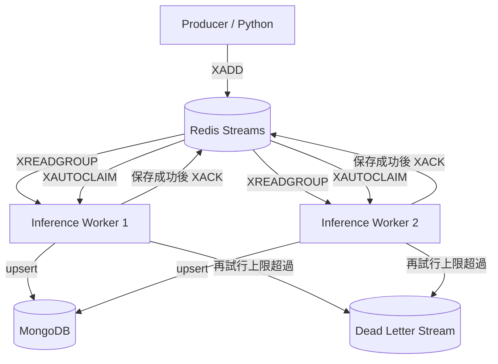
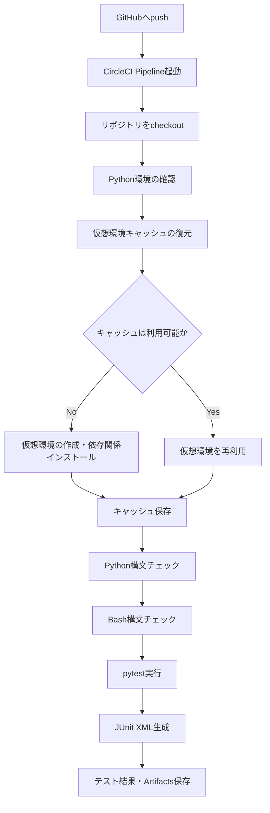
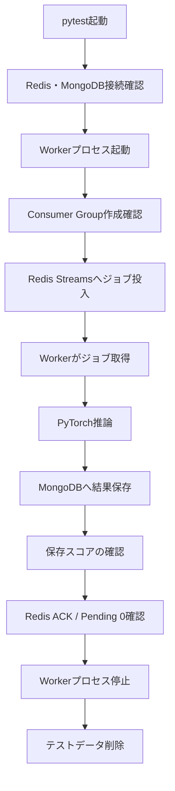

# AI Mobility Inference PoC

Redis Streams、Python / PyTorch、MongoDBを組み合わせた**非同期推論処理基盤の最小構成PoC**です。

Docker Composeで基本動作を確認した後、ローカルKubernetes（kind）へ移行し、ジョブ投入、推論結果の保存、障害発生時の再処理、Workerの並列化、性能計測までを検証しました。

本PoCでは、推論モデルの高度化よりも、**非同期処理基盤の信頼性、データ整合性、障害回復、性能評価、可観測性**に重点を置いています。

> **位置づけ**
>
> AIモビリティ領域のアプリケーション基盤を学習・検証するための個人PoCです。
>
> 実際のVPS（Visual Positioning System）、マルチモーダルモデル、車載システムを実装したものではありません。
>
> 推論処理には疑似画像の平均値計算を使用しています。
>
> 性能測定結果はローカル検証環境における参考値であり、本番環境の性能を保証するものではありません。

## 1. システム構成



Worker 2台は並列処理構成を表しています。通常の動作確認では1台構成も使用します。

| コンポーネント | 役割 | 主な実装 |
| --- | --- | --- |
| Producer | 疑似推論ジョブの生成・投入 | `src/producer.py` |
| Redis Streams | 非同期ジョブキュー | `inference_jobs` |
| Consumer Group | 複数Workerへのジョブ配信 | `inference_workers` |
| Worker | ジョブ取得・検証・推論・保存・ACK | `src/worker.py` |
| 推論ロジック | 疑似画像の平均値計算 | `src/inference.py` |
| デバイス選択 | CPU / GPUデバイス選択 | `src/device.py` |
| MongoDB | 推論結果の保存 | `src/database.py` |
| 再試行制御 | 配信回数・DLQ判定 | `src/retry_policy.py` |
| 性能指標 | Queue / Worker / E2E計算 | `src/performance_metrics.py` |
| Docker Compose | ローカルサービス実行 | `compose.yaml` |
| Kubernetes | Redis / MongoDB / Worker / Producer | `k8s/` |
| ベンチマーク | 100件投入・分析・結果保存 | `scripts/` |

### 1.1 推論モデル

入力値 `input_value` から単一チャネルの16×16疑似画像を生成し、全画素の平均値をスコアとして返します。

```text
input_value
    ↓
16×16 疑似画像テンソル
    ↓
PyTorchによる平均値計算
    ↓
score
    ↓
MongoDBへ保存
    ↓
Redis ACK
```

入力値が `0.5` の場合、概ね `0.5` が返ります。

これは学習済みモデルによる画像認識や位置推定ではありません。

GPUが利用できない場合はCPUを使用します。本PoCのKubernetes性能測定はCPUで実施しました。

### 1.2 設計方針

- ジョブ投入と推論処理をRedis Streamsで分離する。
- MongoDB保存成功後にのみRedis ACKを送信する。
- 未ACKジョブを再取得・再処理できるようにする。
- `job_id` をキーにMongoDBの重複ドキュメントを防止する。
- 再試行上限超過時にはDead Letter Streamへ隔離する。
- Worker数を変更して並列処理を検証する。
- Queue待機時間とWorker処理時間を分離する。
- Worker内部のTensor生成・推論・MongoDB保存時間を分離する。
- 計測条件と分析結果をRun ID単位で保存する。
- 実装済みの機能と検証済みの機能を区別する。

## 2. 開発・検証環境

2026年10月20〜21日に使用した主な検証環境です。

| 項目 | 環境 |
| --- | --- |
| ホスト環境 | Windows / WSL2 Linux |
| Python | 3.14系 |
| Docker Engine | 29系 |
| Docker Compose | v2 |
| kind | v0.33.0 |
| Kubernetes | v1.37.0 |
| PyTorch | 2.14.1+cpu |
| NumPy | 2.5.4 |
| Redis | 7系 |
| MongoDB | 8系 |
| redis-py | 6系 |
| PyMongo | 4系 |
| 推論デバイス | CPU |

依存ライブラリは [`requirements.txt`](requirements.txt) を参照してください。

### 2.1 検証環境の制約

WSL2のメモリは約7.6GiB、Swapは2.0GiBです。

性能測定時にはSwap使用量が上限に達していたことがあります。

このため、測定結果には以下の影響が含まれる可能性があります。

- ホストのメモリ圧迫
- CPUスケジューリング
- Kubernetes Podの実行状態
- MongoDBの書き込みタイミング
- Workerの初回処理
- Docker / WSL2環境の負荷変動

**本READMEの性能数値は特定のローカル環境で得られた実測値であり、本番環境の性能保証値ではありません。**

## 3. Docker Composeで動かす

プロジェクトルートで実行します。

### 3.1 サービスの起動

```bash
docker compose up -d --build redis mongo worker

docker compose ps
```

### 3.2 Producerによる投入

```bash
docker compose run --rm producer
```

Workerログを確認します。

```bash
docker compose logs --tail=30 worker
```

### 3.3 MongoDB保存結果の確認

```bash
docker compose exec -T mongo \
  mongosh ai_mobility --quiet --eval \
  'db.inference_results.find({}, {_id:1, input_value:1, score:1, device:1}).forEach(printjson)'
```

保存件数：

```bash
docker compose exec -T mongo \
  mongosh ai_mobility --quiet --eval \
  'db.inference_results.countDocuments({})'
```

### 3.4 Redis Pending確認

```bash
docker compose exec -T redis \
  redis-cli XPENDING inference_jobs inference_workers
```

正常処理後にPendingが残っていなければ0件になります。

### 3.5 停止

```bash
docker compose down
```

> `docker compose down -v` はボリュームも削除します。保存データを保持する場合は実行しないでください。

## 4. kind / Kubernetesで動かす

### 4.1 前提条件

- Docker、kind、kubectlが使用できる。
- kindクラスタが作成済みである。
- KubernetesノードがReadyである。
- 必要なDockerイメージをkindへ読み込める。
- PVCを使用できるStorageClassが存在する。

検証には `go-k8s-poc` クラスタを使用しました。

```bash
kind get clusters

kubectl get nodes

kubectl get storageclass
```

### 4.2 Dockerイメージのビルドと読み込み

基本構成：

```bash
docker build -t ai-mobility-inference-poc:cpu .

kind load docker-image \
  ai-mobility-inference-poc:cpu \
  --name go-k8s-poc
```

2026年10月21日の詳細計測検証では、次のイメージを使用しました。

```text
ai-mobility-inference-poc:metrics-20261021-01
```

Workerへ適用する例：

```bash
kubectl -n ai-mobility-poc set image \
  deployment/inference-worker \
  worker=ai-mobility-inference-poc:metrics-20261021-01

kubectl -n ai-mobility-poc rollout status \
  deployment/inference-worker \
  --timeout=180s
```

このタグは2026年10月21日のローカル検証用です。利用前に対象イメージをビルドし、kindクラスタへ読み込んでください。

また、Deploymentのイメージを変更した場合は、`k8s/worker.yaml` の設定との差分に注意してください。

### 4.3 マニフェストの適用

```bash
kubectl apply -f k8s/namespace.yaml

kubectl apply -f k8s/redis.yaml

kubectl -n ai-mobility-poc rollout status \
  deployment/redis --timeout=120s

kubectl apply -f k8s/mongo.yaml

kubectl -n ai-mobility-poc rollout status \
  statefulset/mongo --timeout=180s

kubectl apply -f k8s/worker.yaml

kubectl -n ai-mobility-poc rollout status \
  deployment/inference-worker --timeout=120s
```

起動確認：

```bash
kubectl -n ai-mobility-poc get pods -o wide

kubectl -n ai-mobility-poc get svc

kubectl -n ai-mobility-poc get pvc

kubectl -n ai-mobility-poc \
  logs deployment/inference-worker --tail=30
```

### 4.4 Producer Jobによる投入

```bash
kubectl apply -f k8s/producer-job.yaml

kubectl -n ai-mobility-poc wait \
  --for=condition=complete \
  job/inference-producer \
  --timeout=120s

kubectl -n ai-mobility-poc \
  logs job/inference-producer
```

Kubernetes Jobは、同じ名前で再度 `apply` しても自動的には再実行されません。

再実行する場合は、Jobの削除・再作成、または別名のJob作成が必要です。

### 4.5 結果確認

MongoDB：

```bash
kubectl -n ai-mobility-poc exec mongo-0 -- \
  mongosh ai_mobility --quiet --eval \
  'db.inference_results.countDocuments({})'
```

Redis：

```bash
kubectl -n ai-mobility-poc exec deployment/redis -- \
  redis-cli XPENDING inference_jobs inference_workers
```

Worker：

```bash
kubectl -n ai-mobility-poc \
  logs deployment/inference-worker --tail=30
```

## 5. 障害耐性と再試行設計

### 5.1 Redis Streamsの利用

当初のRedis Listを利用した `BRPOP` 方式から、Redis StreamsとConsumer Groupを利用する設計に変更しました。

通常処理は以下の順序です。

1. Producerが `XADD` でジョブを登録する。
2. Workerが `XREADGROUP` でジョブを取得する。
3. Workerが入力値を検証する。
4. PyTorchで推論を実行する。
5. MongoDBに結果を保存する。
6. 保存成功後に `XACK` を送信する。

MongoDB保存に失敗した場合、通常処理のACKは送信せず、ジョブをPendingに残します。

### 5.2 MongoDBへの重複防止保存

MongoDBには `job_id` を `_id` として保存します。

```python
collection.replace_one(
    {"_id": job_id},
    {"_id": job_id, **result},
    upsert=True,
)
```

同じ `job_id` が再処理された場合は、同じキーのドキュメントを置き換えます。

これによってMongoDB上の重複ドキュメントを防ぎます。

ただし、**RedisとMongoDBをまたぐexactly-once処理を保証するものではありません。**

### 5.3 Pendingジョブの再回収

Workerは `XAUTOCLAIM` を利用して、一定時間Pendingとなったジョブを再取得します。

検証時の閾値：

```python
RECLAIM_IDLE_MS = 30_000
```

30秒以上アイドル状態のPendingジョブが再回収対象となります。

これは障害検証用の設定です。

実運用では、正常な推論処理時間、MongoDB書き込み時間、負荷状態を考慮した調整が必要です。

### 5.4 再試行上限とDLQ

再試行制御は `src/retry_policy.py` に分離しています。

配信回数はRedis Pending情報から取得します。

```python
client.xpending_range(...)
```

検証した設定では最大3回の配信を処理対象とし、4回目の配信時に再試行上限超過として隔離しました。

隔離先：

```text
inference_jobs_dead
```

隔離記録には元のStream IDやエラー理由などを保存します。

### 5.5 DLQ登録とACK

Dead Letter Streamへの登録と元ジョブのACKにはRedisトランザクション付きPipelineを使用します。

```python
with client.pipeline(transaction=True) as pipe:
    pipe.xadd(DEAD_LETTER_STREAM, record)
    pipe.xack(STREAM_NAME, GROUP_NAME, message_id)
    results = pipe.execute()
```

これによってDLQ登録とACKをRedisトランザクション内で実行します。

ただし、外部システムとの整合性や障害時のすべての条件を保証するものではありません。

### 5.6 障害復旧検証

| 検証シナリオ | 結果 |
| --- | --- |
| Worker停止・Pod再作成 | Pendingジョブの再回収を確認 |
| MongoDB停止時の保存失敗 | ACKせずPendingに残る |
| MongoDB復旧後の再処理 | 保存成功とACKを確認 |
| 不正入力値 | DLQへの隔離を確認 |
| 再試行上限超過 | 4回目の配信でDLQ隔離 |
| DLQ隔離後 | 元ジョブのACKを確認 |
| 正常ジョブ | MongoDB保存とACKを確認 |

これらはローカルkind環境における検証結果です。

Redis自体の長時間停止、複数ノード障害、ネットワーク分断、永続ストレージ障害からの復旧までは検証していません。

### 5.7 処理保証の位置づけ

本PoCは**at-least-onceを目指した非同期処理設計**です。

ただし、再試行上限を設けているため、すべてのジョブの正常完了を保証するものではありません。

主な制約：

- 同じジョブが複数回推論される可能性がある。
- MongoDB保存とRedis ACKは分散トランザクションではない。
- 再試行上限超過時にはDLQへ隔離する。
- DLQからの自動再投入は未実装。
- 指数バックオフによる再試行調整は未実装。

## 6. 性能計測と検証結果

2026年10月20〜21日に実施した性能検証をまとめます。

### 6.1 計測の目的

推論処理そのものの速度だけでなく、ジョブ投入から結果保存までの時間を分析します。

| 指標 | 意味 |
| --- | --- |
| `elapsed_ms` | Worker処理開始からACK処理後まで |
| `queue_ms` | Redis登録からWorker処理開始まで |
| `worker_ms` | Worker処理開始からMongoDB保存成功まで |
| `e2e_ms` | Redis登録からMongoDB保存成功まで |
| `redis_wait_ms` | Redis登録から取得結果受信まで |
| `dispatch_wait_ms` | 取得結果受信から処理開始まで |
| `tensor_ms` | 疑似画像テンソル生成時間 |
| `inference_ms` | PyTorch推論時間 |
| `mongo_save_ms` | MongoDB保存処理時間 |

ログ例：

```text
Processed: job_id=..., stream_id=..., score=...,
elapsed_ms=..., queue_ms=..., worker_ms=...,
e2e_ms=..., redis_wait_ms=...,
dispatch_wait_ms=..., tensor_ms=...,
inference_ms=..., mongo_save_ms=..., ack=1
```

### 6.2 計測区間の関係

```text
Queue Latency
    = Redis Wait
    + Dispatch Wait

End-to-End Latency
    = Queue Latency
    + Worker Latency
```

計算上は次の関係となります。

```text
queue_ms ≒ redis_wait_ms + dispatch_wait_ms

e2e_ms ≒ queue_ms + worker_ms
```

各計測値は丸め処理の影響でわずかな差が生じる場合があります。

`redis_wait_ms` はRedisサーバー内部の待機時間だけを表すものではありません。

先行ジョブの処理によってWorkerが次の取得APIを呼び出せない時間や、通信・応答時間も含みます。

### 6.3 Stream IDによる登録時刻取得

Redis StreamsのメッセージIDに含まれるミリ秒単位のタイムスタンプを、ジョブ登録時刻として利用します。

```text
1792482417239-0
```

先頭の数値をUnix時刻のミリ秒として解釈し、Worker側で取得したUTC時刻との差分を計算します。

この方式はRedisサーバーとWorkerの時計の整合性に依存します。

### 6.4 Docker Composeの基本検証

初期3件投入で次を確認しました。

| 項目 | 結果 |
| --- | --- |
| Redis Streamsへの投入 | 3件成功 |
| Worker推論 | 3件成功 |
| MongoDB保存 | 3件成功 |
| Redis ACK | 各件 `ack=1` |
| Pending | 0件 |
| Worker処理時間 | 112.93 / 3.29 / 2.34ms |

これらは初期動作確認時のログであり、ベンチマーク結果ではありません。

### 6.5 Kubernetes基本動作

| 項目 | 結果 |
| --- | --- |
| Redis / MongoDB / Worker | Ready |
| Redis PVC / MongoDB PVC | Bound |
| Producer Job | Completed |
| MongoDB保存 | 成功 |
| Pending | 正常処理後0件 |
| CPU推論 | 成功 |

初期の推論結果：

| `input_value` | `score` | `device` |
| ---: | ---: | --- |
| 0.2 | 0.20000003278255463 | cpu |
| 0.5 | 0.5 | cpu |
| 0.8 | 0.8000001311302185 | cpu |

浮動小数点演算による丸め誤差があります。

### 6.6 100件のPipeline投入

Redis Pipelineを利用して100件のジョブを一括投入する仕組みを実装しました。

使用ファイル：

- `scripts/benchmark_producer.py`
- `k8s/benchmark-producer-job.yaml`

Producer側の実装例：

```python
with client.pipeline(transaction=False) as pipe:
    for i in range(1, count + 1):
        pipe.xadd(
            STREAM_NAME,
            {
                "job_id": f"{run_id}-{i}",
                "input_value": "0.5",
            },
        )
    pipe.execute()
```

2026年10月20日の実測例：

| Run ID | Producer実行時間 | 投入件数 |
| --- | ---: | ---: |
| `perf-pipeline-20261020154224` | 9.869ms | 100 |
| `perf-pipeline-20261020155552` | 3.013ms | 100 |
| `perf-pipeline-20261020160512` | 3.231ms | 100 |

いずれも100件の保存とPending 0件を確認しました。

Producer実行時間はRedisへの投入時間であり、推論完了までの時間ではありません。

### 6.7 Pipeline方式のE2E性能

| Run ID | E2E平均 | E2E p95 | E2E p99 |
| --- | ---: | ---: | ---: |
| `perf-pipeline-20261020154224` | 340.510ms | 454.554ms | 460.938ms |
| `perf-pipeline-20261020155552` | 97.161ms | 162.301ms | 166.915ms |
| `perf-pipeline-20261020160512` | 163.619ms | 269.401ms | 279.541ms |

同じ100件の投入でも、E2E時間には大きなばらつきがありました。

原因候補として、Workerのウォームアップ、WSL2のメモリ・Swap状態、CPUスケジューリング、Redis取得タイミング、MongoDB保存時間などが考えられます。

各要因の寄与度は未確定です。

### 6.8 Queue待機時間の分解

Queue LatencyをRedis取得前と取得後の待機に分離しました。

対象Run ID：

```text
perf-dispatch-20261020163402
```

| 指標 | 平均 | p95 | p99 |
| --- | ---: | ---: | ---: |
| Redis取得前待機 | 167.340ms | 323.177ms | 323.177ms |
| 取得後待機 | 14.465ms | 29.700ms | 36.760ms |
| Queue合計 | 181.805ms | 332.704ms | 341.139ms |

この測定では、Queue Latency平均の約92%がRedis取得前の区間に含まれていました。

ただし、Redisサーバー内部で92%の時間を消費していたという意味ではありません。

### 6.9 READ_BATCH_SIZEの比較

通常の `XREADGROUP` で使用する取得バッチサイズを変更できるようにしました。

```text
READ_BATCH_SIZE
```

未指定時の既定値は10です。

比較した条件：

```text
READ_BATCH_SIZE=10
READ_BATCH_SIZE=1
```

`XAUTOCLAIM` の取得件数は10のままです。

バッチサイズを1に変更する例：

```bash
kubectl -n ai-mobility-poc set env \
  deployment/inference-worker \
  READ_BATCH_SIZE=1

kubectl -n ai-mobility-poc rollout status \
  deployment/inference-worker \
  --timeout=180s
```

元に戻す場合：

```bash
kubectl -n ai-mobility-poc set env \
  deployment/inference-worker \
  READ_BATCH_SIZE=10
```

### 6.10 バッチサイズ別E2E性能

各条件100件の単発測定です。

| 指標 | count=10 | count=1 |
| --- | ---: | ---: |
| 処理成功件数 | 100 | 100 |
| E2E平均 | 183.706ms | 184.300ms |
| E2E p50 | 187.608ms | 193.269ms |
| E2E p95 | 334.119ms | 312.091ms |
| E2E p99 | 342.224ms | 336.475ms |
| E2E最大 | 346.293ms | 338.839ms |

対象Run ID：

```text
count=10: perf-dispatch-20261020163402
count=1 : perf-batch1-20261020164612
```

単発測定では `count=1` のE2E p95が約6.6%短くなりました。

ただし、E2E平均はほぼ同じであり、バッチサイズの最適値はまだ確定できません。

### 6.11 バッチサイズ別の待機時間

| 指標 | count=10 | count=1 |
| --- | ---: | ---: |
| Redis取得前待機・平均 | 167.340ms | 182.362ms |
| Redis取得前待機・p95 | 323.177ms | 310.541ms |
| 取得後待機・平均 | 14.465ms | 0.339ms |
| 取得後待機・p95 | 29.700ms | 0.770ms |
| Queue合計・平均 | 181.805ms | 182.702ms |
| Queue合計・p95 | 332.704ms | 310.737ms |

バッチサイズ1では取得後待機が大きく短縮されました。

一方、Queue全体の平均時間はほとんど変化していません。

つまり、取得後待機の短縮が、そのままE2E性能全体の改善につながるわけではありません。

### 6.12 Workerレプリカ数の比較（Phase 6）

2026年10月21日、Worker 1台と2台の性能を比較しました。

主な条件：

| 項目 | 条件 |
| --- | --- |
| クラスタ | kind / 単一ノード |
| 投入件数 | 各Run 100件 |
| 投入方式 | Redis Pipeline |
| `READ_BATCH_SIZE` | 1 |
| 推論デバイス | CPU |
| Worker数 | 1台 / 2台 |
| 測定回数 | 各3回 |
| ウォームアップ | 各構成で実施 |

E2E p95の結果：

| Run | Worker 1台 | Worker 2台 |
| --- | ---: | ---: |
| 1 | 365.421ms | 414.752ms |
| 2 | 442.166ms | 162.400ms |
| 3 | 471.186ms | 170.095ms |
| **中央値** | **442.166ms** | **170.095ms** |

この3回の測定では、Worker 2台構成のE2E p95中央値が約61.5%短くなりました。

Redis取得前待機のp95中央値：

| 条件 | p95中央値 |
| --- | ---: |
| Worker 1台 | 441.203ms |
| Worker 2台 | 168.204ms |

Workerの並列化によって後続ジョブの待機が短縮される可能性を確認しました。

ただし、Worker 2台構成のRun 1では、初期ジョブに約175〜183msのWorker処理時間が発生し、その後のジョブに影響した可能性があります。

また、測定順序、ホスト負荷、メモリ状態などを十分に統制できていないため、**Worker数の増加だけが性能差の原因であるとは断定できません。**

### 6.13 Worker内部処理の詳細計測（Phase 7）

Worker内部の処理時間を以下に分解しました。

```text
Worker Latency
    ├── Tensor生成
    ├── PyTorch推論
    ├── MongoDB保存
    └── 入力検証・計測などの付随処理
```

追加した計測項目：

| 指標 | 内容 |
| --- | --- |
| `tensor_ms` | Tensor生成 |
| `inference_ms` | PyTorch推論 |
| `mongo_save_ms` | MongoDB保存 |
| `worker_ms` | Worker全体 |

`mongo_save_ms` は `save_result()` の呼び出し全体の経過時間です。

MongoDBサーバー内部の純粋な書き込み時間だけを示す値ではありません。

計測用Dockerイメージ：

```text
ai-mobility-inference-poc:metrics-20261021-01
```

Worker 1台・100件×3回の測定結果：

| Run ID | Worker最大 | MongoDB p95 | MongoDB最大 | 推論 p95 |
| --- | ---: | ---: | ---: | ---: |
| `perf-r1-20261021110159-1` | 17.556ms | 2.225ms | 17.262ms | 0.267ms |
| `perf-r1-20261021110626-1` | 4.303ms | 2.363ms | 3.199ms | 0.396ms |
| `perf-r1-20261021110634-2` | 3.468ms | 1.800ms | 2.527ms | 0.316ms |

3回のp95中央値：

| 指標 | 中央値 |
| --- | ---: |
| MongoDB保存 | 2.225ms |
| PyTorch推論 | 0.316ms |

この測定では、推論処理は通常1ms未満で完了していました。

一方、MongoDB保存がWorker内部処理時間の大きな割合を占めるケースがありました。

### 6.14 MongoDB保存時間の変動

詳細計測を追加した後の別Runでは、MongoDB保存時間にさらに大きな変動が見られました。

| Run ID | E2E p95 | MongoDB p95 | MongoDB最大 |
| --- | ---: | ---: | ---: |
| `perf-r1-20261021112337-1-2469239` | 787.866ms | 8.235ms | 102.071ms |
| `perf-r1-20261021114040-1-2488703` | 283.742ms | 1.360ms | — |
| `perf-r1-20261021114904-1-2498272` | 380.034ms | 1.494ms | 106.875ms |

最初のRunでは以下のジョブが特に遅くなりました。

| ジョブ | Worker全体 | Tensor生成 | 推論 | MongoDB保存 |
| --- | ---: | ---: | ---: | ---: |
| 1 | 141.898ms | 15.399ms | 22.424ms | 102.071ms |
| 2 | 31.225ms | 0.110ms | 0.274ms | 30.806ms |
| 26 | 54.224ms | 0.113ms | 0.287ms | 53.781ms |

MongoDB保存の突発的な遅延は複数回観測されました。

ただし、現時点では以下のどの要因によるものか特定していません。

- MongoDBサーバー内部の処理
- PyMongoのクライアント側処理
- ネットワーク通信
- ホスト環境の負荷変動
- ストレージI/O
- その他の実行環境要因

### 6.15 MongoDB接続管理の確認

`src/database.py` では、Worker起動時に `MongoClient` を生成し、取得したCollectionをジョブ処理で使い回します。

```python
def get_collection():
    client = MongoClient(
        os.getenv("MONGO_URI", "mongodb://mongo:27017/"),
        serverSelectionTimeoutMS=5000,
    )

    database = client["ai_mobility"]
    return database["inference_results"]
```

保存処理：

```python
collection.replace_one(
    {"_id": job_id},
    {"_id": job_id, **result},
    upsert=True,
)
```

Worker自身がジョブごとに `MongoClient` を新規作成する実装ではありません。

また、調査時点で以下を確認しました。

- MongoDB接続拒否は0件。
- 接続確立待ちは0件。
- ロック待機は0件。
- WiredTigerキャッシュ使用量は上限に対して小さい。
- WorkerとMongoDBのPod再起動は0回。

ただし、これらは主に負荷試験後の状態であり、試験中の瞬間的な異常を否定するものではありません。

### 6.16 ベンチマーク自動化（Phase 8）

2026年10月21日、`scripts/run_replica_benchmark.sh` により、ベンチマークの実行と結果収集を自動化しました。

主な処理：

1. Workerレプリカ数を検証する。
2. Redis Pendingが0件であることを確認する。
3. Run IDを生成する。
4. Producer Jobを作成して100件投入する。
5. MongoDBの保存件数を確認する。
6. Redis Pendingが0件になるまで待機する。
7. Pod別のWorkerログを収集する。
8. E2E / Dispatch / Worker内部処理時間を分析する。
9. MongoDB統計を実行前後で取得する。
10. MongoDB統計差分を計算する。
11. 結果をJSONおよびCSVへ保存する。

実行例：

```bash
./scripts/run_replica_benchmark.sh 1 3
```

引数：

```text
第1引数：Workerレプリカ数（1または2）
第2引数：実行回数（省略時3）
```

Worker 2台構成の場合：

```bash
kubectl -n ai-mobility-poc scale \
  deployment/inference-worker --replicas=2

kubectl -n ai-mobility-poc rollout status \
  deployment/inference-worker --timeout=180s

./scripts/run_replica_benchmark.sh 2 3
```

測定スクリプト自体はWorker数を変更しません。

Deploymentの希望レプリカ数とReadyレプリカ数が指定値に一致していることを確認して実行します。

詳細計測に対応したWorkerイメージを使用してください。

### 6.17 ベンチマークの出力ファイル

結果はRun IDごとのディレクトリに保存します。

```text
output/
└── replica-comparison/
    ├── worker1/
    │   ├── summary.csv
    │   └── perf-r1-<日時>-<回数>-<PID>/
    │       ├── job.yaml
    │       ├── producer.json
    │       ├── worker.log
    │       ├── workers.csv
    │       ├── <Pod名>.log
    │       ├── e2e.json
    │       ├── dispatch.json
    │       ├── breakdown.json
    │       ├── mongodb-before.json
    │       ├── mongodb-after.json
    │       └── mongodb-delta.json
    └── worker2/
        ├── summary.csv
        └── <Run ID>/
```

| ファイル | 内容 |
| --- | --- |
| `job.yaml` | 実行したProducer Jobの定義 |
| `producer.json` | 投入件数・投入時間 |
| `worker.log` | 対象Run IDのWorkerログ |
| `workers.csv` | Pod別処理件数 |
| `e2e.json` | E2E / Queue / Worker分析 |
| `dispatch.json` | Redis取得前・取得後待機 |
| `breakdown.json` | Tensor生成・推論・MongoDB保存時間 |
| `mongodb-before.json` | 実行前のMongoDB統計 |
| `mongodb-after.json` | 実行後のMongoDB統計 |
| `mongodb-delta.json` | MongoDB統計差分 |
| `summary.csv` | Run単位の主要指標一覧 |

スクリプトは各Runについて100件の完了と詳細計測ログの整合性を確認します。

ただし、現時点ではジョブID単位の重複・欠落確認や測定中のシステムリソース記録には改善余地があります。

### 6.18 MongoDB統計の自動収集

MongoDBの `serverStatus()` を利用し、測定前後の統計値をJSON形式で保存します。

統計取得：

```text
scripts/mongodb/collect_stats.js
```

差分分析：

```text
scripts/mongodb/analyze_stats.py
```

手動取得例：

```bash
kubectl -n ai-mobility-poc exec mongo-0 -- \
  mongosh ai_mobility --quiet --eval \
  "$(cat scripts/mongodb/collect_stats.js)"
```

差分分析例：

```bash
python scripts/mongodb/analyze_stats.py \
  mongodb-before.json \
  mongodb-after.json
```

Run `perf-r1-20261021114040-1-2488703` では以下の差分が確認されました。

| 指標 | 差分 |
| --- | ---: |
| Update操作数 | +100 |
| Query操作数 | +3 |
| 接続作成数 | +9 |
| 接続拒否数 | 0 |
| キャッシュ使用量 | +48,012 bytes |
| Dirty Bytes | +268,770 bytes |

Update操作数は100件のジョブ処理数と一致しました。

ただし、MongoDBの `serverStatus()` はサーバー全体の統計です。

ベンチマーク以外の操作や、保存件数確認用の `mongosh` による接続も含まれます。

また、前後差分は瞬間的な保存遅延の発生原因を直接示すものではありません。

### 6.19 性能検証の総合評価

これまでの検証から、以下を確認しました。

1. Redis Pipelineによる100件投入とMongoDB保存が成功した。
2. 正常完了後のPendingは0件となった。
3. E2E性能はWorker処理時間だけでなく待機時間の影響を強く受ける。
4. `READ_BATCH_SIZE=1` では取得後待機が短縮した。
5. バッチサイズ変更だけではQueue全体の平均時間は大きく改善しなかった。
6. Worker 2台構成ではE2E p95中央値が短縮する傾向が観測された。
7. 継続稼働時の小規模PyTorch推論は通常1ms未満だった。
8. MongoDB保存時間には突発的な100ms超の遅延が観測された。
9. MongoDB接続上限やキャッシュ不足を示す明確な証拠は得られていない。
10. ベンチマーク実行と分析結果の保存を自動化できた。

**Worker数・バッチサイズの最適値、およびMongoDB保存遅延の原因は未確定です。**

## 7. テストと分析スクリプト

### 7.1 pytest

ホスト側のPython仮想環境で実行します。

```bash
python -m venv .venv

source .venv/bin/activate

python -m pip install -r requirements.txt

python -m pip install pytest

python -m pytest -q
```

2026年10月21日時点の確認結果：

```text
31 passed
```

主なテスト対象：

| テストファイル | 対象 |
| --- | --- |
| `tests/test_inference.py` | CPU推論 |
| `tests/test_retry_policy.py` | 再試行上限・DLQ判定 |
| `tests/test_worker_retry.py` | Worker再試行 |
| `tests/test_performance_metrics.py` | レイテンシ計算 |
| `tests/test_analyze_e2e.py` | E2E分析 |
| `tests/test_analyze_worker_breakdown.py` | Worker詳細分析 |
| `tests/test_metric_log_compatibility.py` | 新旧ログ互換性 |

pytestは主にロジック単位の検証です。

実際のRedis、MongoDB、Kubernetesを使用した障害試験や負荷試験は別途実施しました。

### 7.2 分析スクリプト

| ファイル | 用途 |
| --- | --- |
| `scripts/analyze_performance.py` | Worker処理時間分析 |
| `scripts/analyze_e2e.py` | Queue / Worker / E2E分析 |
| `scripts/analyze_dispatch.py` | Redis待機時間分解 |
| `scripts/analyze_worker_breakdown.py` | Worker詳細計測 |
| `scripts/benchmark_producer.py` | Redis Pipeline投入 |
| `scripts/run_benchmark.sh` | 既存の繰り返し試験 |
| `scripts/run_replica_benchmark.sh` | レプリカ比較・自動集計 |
| `scripts/mongodb/collect_stats.js` | MongoDB統計取得 |
| `scripts/mongodb/analyze_stats.py` | MongoDB統計差分分析 |

### 7.3 E2E分析

```bash
python scripts/analyze_e2e.py \
  output/worker.log \
  perf-example 100
```

主な出力項目：

```text
completed_jobs
completion_rate_percent
queue_latency
worker_latency
end_to_end_latency
```

各レイテンシは以下の統計を持ちます。

```text
mean_ms
p50_ms
p95_ms
p99_ms
max_ms
```

### 7.4 Redis待機時間分析

```bash
python scripts/analyze_dispatch.py \
  output/worker.log \
  perf-example
```

主な出力：

```text
completed_jobs
redis_wait_latency
dispatch_wait_latency
queue_latency
max_decomposition_error_ms
```

### 7.5 Worker内部処理分析

```bash
python scripts/analyze_worker_breakdown.py \
  output/worker.log \
  perf-example
```

主な出力：

```text
completed_jobs_with_breakdown
worker_ms
tensor_ms
inference_ms
mongo_save_ms
slowest_jobs
```

旧ログ形式のデータには詳細計測項目が存在しないため、その場合は詳細分析の対象外となります。

### 7.6 PipelineベンチマークJob

ProducerスクリプトをConfigMapへ登録します。

```bash
kubectl -n ai-mobility-poc create configmap \
  benchmark-producer \
  --from-file=benchmark_producer.py=scripts/benchmark_producer.py \
  --dry-run=client -o yaml | kubectl apply -f -
```

Jobテンプレート：

```text
k8s/benchmark-producer-job.yaml
```

Job名の重複を防ぎ、Run ID単位でデータを分離するため、通常は `run_replica_benchmark.sh` の利用を推奨します。

### 7.7 テスト上の注意

- 正常ACKされた対象Run IDのジョブのみ分析する。
- `completed_jobs` が期待件数と一致することを確認する。
- 新旧ログ形式の互換性を維持する。
- Worker詳細分析では計測値がすべて存在するジョブのみ対象とする。
- MongoDB統計はサーバー全体の値として扱う。
- 性能比較では測定条件を記録する。
- Bash内Python集計処理の独立テストは今後の課題とする。

## 8. 制約と今後の課題

### 8.1 推論機能

- 現在は疑似画像の平均値計算のみ。
- 実画像認識は未実装。
- VPS位置推定は未実装。
- マルチモーダル統合は未実装。
- 学習済みモデルの精度評価は対象外。

### 8.2 GPU対応

- CPU推論は検証済み。
- CUDA推論は未検証。
- Kubernetes上のGPU割り当ては未検証。
- CPU / GPU性能比較は未実施。

### 8.3 障害耐性

検証済み：

- Worker停止からのPending再回収
- MongoDB停止・復旧後の再処理
- 不正入力のDLQ隔離
- 再試行上限超過時の隔離
- 保存成功後のACK

未検証・未実装：

- 指数バックオフ
- DLQからの自動再投入
- Redis自体の長時間障害復旧
- 複数ノード障害
- ネットワーク分断への耐性

### 8.4 データ整合性

MongoDB保存とRedis ACKは分散トランザクションではありません。

upsertにより同一 `job_id` の重複ドキュメントは防止していますが、システム全体としてexactly-onceを保証するものではありません。

### 8.5 セキュリティ

RedisとMongoDBはローカル学習用に認証なしで構成しています。

共有環境や本番環境へそのまま配置しないでください。

実運用では次の対策が必要です。

- 認証・認可
- TLSによる通信暗号化
- Kubernetes Secret管理
- ネットワーク制御
- コンテナ権限管理
- イメージの脆弱性管理

### 8.6 可観測性

現在は標準出力ログとJSONレポートを中心に計測しています。

未整備の項目：

- JSON形式の構造化ログ
- Prometheusメトリクス
- Grafanaダッシュボード
- アラート通知
- 分散トレーシング
- 継続的なエラー率監視
- 実行中のCPU・メモリ統計収集

### 8.7 性能評価

実施済み：

- 100件Pipeline投入
- E2E p95 / p99分析
- Queue待機時間の分解
- バッチサイズ1と10の比較
- Worker 1台・2台の反復比較
- Worker内部処理時間の分解
- MongoDB保存時間の詳細計測
- MongoDB統計の前後差分取得
- ベンチマーク自動化

今後の課題：

- バッチサイズ1と10の反復比較
- ウォームアップ条件の統一
- Workerレプリカ比較の測定順序統制
- CPU・メモリ・Swap使用量の同時記録
- スループットの厳密な測定
- MongoDB保存遅延の原因分析
- 高負荷時のエラー率測定
- SLA / SLOに基づく性能判定
- 現実的な推論モデルによる負荷試験

### 8.8 永続性と可用性

RedisとMongoDBにはPVCを使用していますが、単一ノードkind構成です。

バックアップ・リストア、複数ノード障害、データセンター障害に対する可用性は検証していません。

### 8.9 ベンチマーク実装の改善課題

2026年10月21日のベンチマーク実行では、Bash内部のPython集計処理において、変数 `expected` の定義前参照による `NameError` が発生しました。

Producer投入、Worker処理、MongoDB保存、JSONレポート生成は完了していたため、保存済みデータから `summary.csv` を復旧しました。

今後の改善：

1. Bash内部の集計処理を独立したPythonモジュールへ分離する。
2. 単体テストで集計処理の成功・失敗条件を検証する。
3. 中断したRunを安全に再集計できる機能を追加する。
4. `summary.csv` への重複登録を防止する。
5. ジョブID単位の重複・欠落を検出する。
6. Pod再起動数・イメージ・リソース状態を保存する。

### 8.10 今後の検証優先順位

1. ベンチマーク集計処理のテスト強化
2. WSL2リソース状態の計測
3. MongoDB保存遅延の詳細分析
4. Worker 1台・2台の再現性比較
5. バッチサイズ1と10の反復比較
6. Pending・DLQ件数の監視
7. CIによるpytest自動実行
8. 実モデルに近い推論処理の検証

## 9. ディレクトリ構成

```text
.
├── Dockerfile
├── .dockerignore
├── compose.yaml
├── requirements.txt
├── README.md
├── src/
│   ├── __init__.py
│   ├── main.py
│   ├── device.py
│   ├── inference.py
│   ├── database.py
│   ├── producer.py
│   ├── worker.py
│   ├── retry_policy.py
│   └── performance_metrics.py
├── scripts/
│   ├── analyze_performance.py
│   ├── analyze_e2e.py
│   ├── analyze_dispatch.py
│   ├── analyze_worker_breakdown.py
│   ├── benchmark_producer.py
│   ├── run_benchmark.sh
│   ├── run_replica_benchmark.sh
│   └── mongodb/
│       ├── collect_stats.js
│       └── analyze_stats.py
├── tests/
│   ├── __init__.py
│   ├── test_inference.py
│   ├── test_retry_policy.py
│   ├── test_worker_retry.py
│   ├── test_performance_metrics.py
│   ├── test_analyze_e2e.py
│   ├── test_analyze_worker_breakdown.py
│   └── test_metric_log_compatibility.py
└── k8s/
    ├── namespace.yaml
    ├── redis.yaml
    ├── mongo.yaml
    ├── worker.yaml
    ├── producer-job.yaml
    └── benchmark-producer-job.yaml
```

`output/` にはベンチマーク時のログ・CSV・JSONレポートを保存します。

実行環境固有のログ、一時生成物、仮想環境、`__pycache__`、バックアップファイルなどは、必要に応じてGit管理対象から除外します。

---


## 10. CircleCIによるCI自動化と高速化（Phase 9）

2026年10月21日、GitHubとCircleCIを連携し、Pythonアプリケーションの継続的インテグレーション（CI）環境を構築しました。

本Phaseでは、GitHubへのpushを契機として、依存ライブラリの準備、ソースコードの構文チェック、pytestの実行、JUnit XMLレポートの保存を自動化しています。

さらに、PyTorchを含むPython仮想環境をキャッシュすることで、CIの実行時間短縮を検証しました。

### 10.1 CI導入の目的

本PoCでは、Redis Streams、PyTorch、MongoDB、Kubernetesを組み合わせた非同期推論処理基盤を実装しています。

機能追加に伴ってテストや計測処理も増加したため、ローカル環境での手動テストだけに依存しない開発体制を整えることを目的としました。

主な目標は以下のとおりです。

- GitHubへのpush時に自動でテストを実行する。
- Python 3.14環境で依存ライブラリを再現する。
- Python・Bashの構文チェックを自動化する。
- 既存のpytest 31件を自動実行する。
- JUnit XML形式のテストレポートを保存する。
- 依存ライブラリの再インストールを削減する。
- CIの実行時間を計測して改善効果を確認する。

### 10.2 CIの実行フロー



本Phaseでは、Redis・MongoDB・Kubernetesを起動する統合試験はCIに含めていません。

まずは、アプリケーションの単体テストとコード検証を安定して実行することを優先しました。

### 10.3 CircleCIの基本構成

CircleCI設定ファイルは以下です。

```text
.circleci/config.yml
```

主な実行条件：

| 項目 | 設定 |
| --- | --- |
| CIサービス | CircleCI |
| ソースコード管理 | GitHub |
| トリガー | GitHubへのpush |
| Executor | Docker |
| Dockerイメージ | `cimg/python:3.14.8` |
| Resource Class | `medium` |
| Python | 3.14.8 |
| PyTorch | 2.14.1+cpu |
| テストフレームワーク | pytest |
| テストレポート | JUnit XML |
| キャッシュ対象 | Python仮想環境 `.venv` |

2026年10月21日の検証では、`main` ブランチで正常にパイプラインが実行されることを確認しました。

### 10.4 PyTorch CPU版の依存関係解決

CircleCI導入時、最初のパイプラインは依存関係のインストール段階で失敗しました。

発生したエラー：

```text
ERROR: Could not find a version that satisfies
the requirement torch==2.14.1+cpu

ERROR: No matching distribution found for torch==2.14.1+cpu
```

原因は、通常のPyPIインデックスから `torch==2.14.1+cpu` を取得できなかったことです。

これに対して、PyTorch CPU版の専用インデックスを明示してインストールする方式へ変更しました。

```bash
python -m pip install \
  torch==2.14.1+cpu \
  --index-url https://download.pytorch.org/whl/cpu
```

その後、`requirements.txt` とpytestをインストールします。

```bash
python -m pip install -r requirements.txt pytest
```

この修正により、CircleCI上で依存関係を解決できるようになりました。

修正後のパイプラインでは、pytest 31件すべてが成功しました。

### 10.5 pytestの自動実行

CircleCIでは、以下の処理を自動実行します。

Python構文チェック：

```bash
python -m compileall -q src scripts tests
```

Bash構文チェック：

```bash
bash -n scripts/run_replica_benchmark.sh
bash -n scripts/run_benchmark.sh
```

pytest：

```bash
python -m pytest -q
```

初回のCI成功時には、以下の結果を確認しました。

```text
31 passed in 1.66s
```

これにより、ローカル環境とは独立したCircleCI実行環境でも、既存のテストがすべて成功することを確認できました。

### 10.6 JUnit XML形式のテストレポート

テスト実行結果をCircleCI上で確認できるように、JUnit XML形式のレポート出力を追加しました。

設定例：

```yaml
- run:
    name: Run pytest
    command: |
      mkdir -p test-results
      .venv/bin/python -m pytest -q \
        --junitxml=test-results/pytest.xml

- store_test_results:
    path: test-results

- store_artifacts:
    path: test-results
```

生成ファイル：

```text
test-results/pytest.xml
```

実行結果：

| 指標 | 結果 |
| --- | ---: |
| テスト件数 | 31 |
| 失敗 | 0 |
| エラー | 0 |
| スキップ | 0 |
| pytest実行時間 | 約1.93秒 |

JUnit XMLにはテストケース名、実行時間、失敗・エラー情報が記録されます。

CircleCIのArtifactsタブから `pytest.xml` を確認できることを検証しました。

なお、XMLをブラウザで直接開いた際にスタイルシートが存在しない旨が表示されることがありますが、JUnit XML自体のエラーではありません。

### 10.7 pipキャッシュ方式の検証

当初は、pipのダウンロードキャッシュをCircleCIに保存する方式を試しました。

キャッシュ対象：

```text
/home/circleci/.cache/pip
```

使用したCircleCI機能：

```yaml
- restore_cache:
    keys:
      - pip-v1-py314-{{ arch }}-{{ checksum "requirements.txt" }}

- save_cache:
    key: pip-v1-py314-{{ arch }}-{{ checksum "requirements.txt" }}
    paths:
      - ~/.cache/pip
```

検証結果：

| 項目 | 結果 |
| --- | --- |
| キャッシュ保存 | 成功 |
| キャッシュ復元 | 成功 |
| キャッシュ容量 | 238MiB |
| Cache Miss時の実行時間 | 47秒 |
| Cache Hit時の実行時間 | 71秒 |

pipのキャッシュは正常に再利用されていました。

しかし、キャッシュからパッケージを取得できても、ライブラリのインストール処理自体は毎回発生しました。

この測定では、Cache Hit後のジョブ実行時間は短縮しませんでした。

ただし、各実行時のネットワークやホスト負荷を統制できていないため、pipキャッシュそのものが遅延の原因であるとは断定していません。

### 10.8 Python仮想環境キャッシュへの変更

次に、pipのダウンロードキャッシュから、インストール済みPython仮想環境を再利用する方式へ変更しました。

キャッシュ対象：

```text
/home/circleci/project/.venv
```

主なキャッシュキー：

```yaml
- restore_cache:
    keys:
      - venv-v2-py3148-torch2141-{{ arch }}-{{ checksum "requirements.txt" }}
```

キャッシュ保存：

```yaml
- save_cache:
    key: venv-v2-py3148-torch2141-{{ arch }}-{{ checksum "requirements.txt" }}
    paths:
      - .venv
```

キャッシュキーには以下の情報を含めています。

- キャッシュ定義のバージョン
- Pythonバージョン
- PyTorchバージョン
- 実行環境のアーキテクチャ
- `requirements.txt` のチェックサム

同一条件でキャッシュを復元できた場合は、依存ライブラリの再インストールを省略します。

### 10.9 仮想環境の再利用判定

キャッシュを復元できても、仮想環境が正常に動作するとは限りません。

そのため、マーカーファイルの存在に加えて、必要なライブラリのimportとpipの起動を確認する方式にしました。

```bash
if [ -f .venv/.dependencies-ready ] && \
   .venv/bin/python -c "import torch, numpy, redis, pymongo, pytest" && \
   .venv/bin/python -m pip --version; then

  echo "Using cached Python environment"

else
  echo "Creating Python environment"

  rm -rf .venv
  python -m venv .venv

  .venv/bin/python -m pip install \
    torch==2.14.1+cpu \
    --index-url https://download.pytorch.org/whl/cpu

  .venv/bin/python -m pip install \
    -r requirements.txt pytest

  touch .venv/.dependencies-ready
fi
```

再実行時には、以下のログを確認しました。

```text
Using cached Python environment
Python 3.14.8
pytest 9.1.1
```

これによって、仮想環境の復元後にライブラリを再インストールせず、テスト環境を再利用できたことを確認しました。

ただし、importの成功だけで依存関係の完全な整合性を保証するものではありません。

Dockerイメージの変更や依存関係の更新時には、キャッシュキーの見直しが必要です。

### 10.10 CI高速化の測定結果

2026年10月21日の実測値を以下に示します。

| キャッシュ方式 | 条件 | ジョブ実行時間 |
| --- | --- | ---: |
| キャッシュなし | 初期CI | 56秒 |
| pipキャッシュ | Cache Miss | 47秒 |
| pipキャッシュ | Cache Hit | 71秒 |
| 仮想環境キャッシュ | Cache Miss | 80秒 |
| 仮想環境キャッシュ | Cache Hit | **39秒** |

仮想環境キャッシュの初回実行では、依存ライブラリのインストールとキャッシュ保存に時間がかかりました。

一方、同じキャッシュを利用した再実行では39秒で完了しました。

同一方式の初回実行と再利用時を比較すると、次のようになります。

```text
仮想環境キャッシュ初回 : 80秒
仮想環境キャッシュ再利用 : 39秒

短縮時間 : 41秒
短縮率   : 約51.3%
```

キャッシュを使用しない初期CIの56秒と比較した場合は、17秒の短縮です。

ただし、測定回数が少なく、実行環境の変動も含まれるため、これらの数値は参考値です。

### 10.11 キャッシュ再利用時の詳細

仮想環境キャッシュ再利用時の結果：

| 項目 | 結果 |
| --- | --- |
| CircleCIジョブ | Success |
| ジョブ実行時間 | 39秒 |
| キャッシュ復元 | 成功 |
| Restoring cache | 5秒 |
| キャッシュ容量 | 228MiB |
| Prepare Python environment | 4秒 |
| 依存ライブラリの再インストール | 省略 |
| Saving cache | 既存キャッシュのためスキップ |

ログ：

```text
Found a cache from job 7
Size: 228 MiB

Using cached Python environment
Python 3.14.8
pytest 9.1.1
```

キャッシュ保存時には以下のログも確認しました。

```text
Skipping cache generation,
cache already exists for key...
```

これは、同一キーのキャッシュがすでに存在するため、再保存を行わないという意味です。

### 10.12 最終的なCircleCI設定

2026年10月21日時点で使用した設定例です。

```yaml
version: 2.1

jobs:
  test:
    docker:
      - image: cimg/python:3.14.8

    resource_class: medium

    steps:
      - checkout

      - run:
          name: Check Python version
          command: |
            python --version

      - restore_cache:
          keys:
            - venv-v2-py3148-torch2141-{{ arch }}-{{ checksum "requirements.txt" }}

      - run:
          name: Prepare Python environment
          command: |
            set -e

            if [ -f .venv/.dependencies-ready ] && \
               .venv/bin/python -c "import torch, numpy, redis, pymongo, pytest" && \
               .venv/bin/python -m pip --version; then
              echo "Using cached Python environment"
            else
              echo "Creating Python environment"

              rm -rf .venv
              python -m venv .venv

              .venv/bin/python -m pip install \
                torch==2.14.1+cpu \
                --index-url https://download.pytorch.org/whl/cpu

              .venv/bin/python -m pip install \
                -r requirements.txt pytest

              touch .venv/.dependencies-ready
            fi

            .venv/bin/python --version
            .venv/bin/python -m pytest --version

      - save_cache:
          key: venv-v2-py3148-torch2141-{{ arch }}-{{ checksum "requirements.txt" }}
          paths:
            - .venv

      - run:
          name: Check Python syntax
          command: |
            .venv/bin/python -m compileall -q src scripts tests

      - run:
          name: Check Bash syntax
          command: |
            bash -n scripts/run_replica_benchmark.sh
            bash -n scripts/run_benchmark.sh

      - run:
          name: Run pytest
          command: |
            mkdir -p test-results
            .venv/bin/python -m pytest -q \
              --junitxml=test-results/pytest.xml

      - store_test_results:
          path: test-results

      - store_artifacts:
          path: test-results

workflows:
  ci:
    jobs:
      - test
```

実際に使用する設定は、リポジトリ内の `.circleci/config.yml` を正本とします。

### 10.13 Phase 9の検証結果

本Phaseでは以下の項目を検証しました。

| 検証項目 | 結果 |
| --- | --- |
| GitHubとCircleCIの連携 | 成功 |
| GitHub pushによるCI起動 | 成功 |
| Python 3.14環境の構築 | 成功 |
| PyTorch CPU版のインストール | 成功 |
| Python構文チェック | 成功 |
| Bash構文チェック | 成功 |
| pytest 31件 | 成功 |
| JUnit XML生成 | 成功 |
| Artifacts保存 | 成功 |
| pipキャッシュの保存・復元 | 成功 |
| 仮想環境キャッシュの保存・復元 | 成功 |
| 仮想環境の再インストール省略 | 確認 |
| 仮想環境キャッシュによる高速化 | 観測 |

**Phase 9の目標であるCI自動化、テスト結果の保存、キャッシュ再利用による高速化は達成しました。**

### 10.14 今後の改善課題

今回構築したCIは、Python単体テストを中心とした最小構成です。

今後の課題は以下のとおりです。

1. キャッシュ再利用時の実行時間を複数回測定し、効果の再現性を確認する。
2. Dockerイメージの更新とキャッシュの整合性を管理する。
3. Python依存関係のバージョン固定を強化する。
4. DockerイメージのビルドをCIに追加する。
5. Kubernetesマニフェストの構文・スキーマ検証を追加する。
6. Redis・MongoDBを使用する統合テストを追加する。
7. テストカバレッジを計測する。
8. Pull Request時のチェックとブランチ保護を整備する。
9. 必要に応じて脆弱性スキャンを導入する。
10. CIからのCD（継続的デリバリー／デプロイ）を検討する。

特に次の段階では、**CircleCI上でDockerイメージをビルドし、Kubernetesへ適用する前に成果物を検証する仕組み**を構築することを候補としています。

ただし、本PoCは単一ノードkindによるローカル学習環境であり、現時点で本番環境への自動デプロイは目的としていません。

---


## まとめ

本PoCでは、Redis Streams、Python / PyTorch、MongoDBを利用した非同期推論処理基盤を構築し、Docker ComposeおよびKubernetes上で段階的に検証しました。

確認した主な機能は以下です。

- Redis Streamsによる非同期ジョブ処理
- MongoDB保存成功後のACK
- Pendingジョブの再回収
- MongoDB停止・復旧時の再処理
- 再試行上限とDead Letter Stream
- 100件のPipeline投入・結果保存
- Queue / Worker / E2Eレイテンシ計測
- Redis取得前・取得後待機の分離
- 取得バッチサイズ1と10の比較
- Worker 1台・2台の性能比較
- Tensor生成・PyTorch推論・MongoDB保存時間の分解
- MongoDB統計の収集・差分分析
- ベンチマーク実行と結果保存の自動化
- pytest 31件成功

Worker 2台構成ではE2E待機時間の短縮傾向が観測されましたが、測定環境の変動を十分に取り除けていないため、改善率の一般化には追加検証が必要です。

また、MongoDB保存処理で100msを超える突発的な遅延が観測されましたが、その原因はまだ特定できていません。

**本リポジトリは、非同期処理・Kubernetes・障害耐性・性能評価について、設計、実装、実測、分析、改善を段階的に積み重ねるための学習用PoCです。**


CircleCIの導入によって、これまでローカル環境で実施していたPython単体テストと構文チェックを、GitHubへのpushに連動して自動実行できるようになりました。

また、JUnit XML形式のテストレポートを保存し、CIの実行結果を継続的に確認できる環境を整備しました。

依存ライブラリのキャッシュ方式については、pipキャッシュとPython仮想環境キャッシュを比較しました。

今回の測定では、仮想環境キャッシュの再利用時にジョブ実行時間が39秒となり、初回実行の80秒から41秒短縮しました。

**CIを構築するだけでなく、実際のログと計測値を基に実行方式を改善し、その効果を検証しました。**


## 11. CircleCIによるDockerイメージ検証（Phase 10）

2026年10月21日、CircleCIのCIパイプラインにDockerイメージのビルド・起動検証を追加しました。

Phase 9ではPython単体テストの自動化を実施しましたが、Phase 10では、実際にKubernetesへ配置するコンテナイメージが正常にビルドできることを検証対象としました。

### 11.1 検証目的

- GitHubへのpush時にDockerイメージを自動ビルドする。
- Dockerfileのビルドエラーを検出する。
- ビルドしたイメージをコンテナとして起動する。
- コンテナ内でPythonとPyTorchが正常に動作することを確認する。
- Python単体テストとDockerビルド検証を独立したジョブで実行する。

### 11.2 Dockerビルドジョブ

CircleCIでは `setup_remote_docker` を利用し、Dockerイメージをビルドします。

設定例：

```yaml
docker-build:
  docker:
    - image: cimg/base:stable

  resource_class: medium

  steps:
    - checkout

    - setup_remote_docker

    - run:
        name: Check Docker environment
        command: |
          docker version
          docker info

    - run:
        name: Build inference worker image
        command: |
          docker build \
            --tag ai-mobility-inference-poc:ci \
            .

    - run:
        name: Verify Docker image
        command: |
          docker image inspect \
            ai-mobility-inference-poc:ci \
            --format 'Image ID: {{.Id}}'

          docker image inspect \
            ai-mobility-inference-poc:ci \
            --format 'Image size: {{.Size}} bytes'

    - run:
        name: Smoke test Docker image
        command: |
          docker run --rm \
            --entrypoint python \
            ai-mobility-inference-poc:ci \
            -c "import torch; print('PyTorch:', torch.__version__)"
```

### 11.3 実行結果

| 項目 | 結果 |
| --- | --- |
| CIジョブ | `docker-build` |
| 実行環境 | Remote Docker / Medium |
| Dockerイメージビルド | 成功 |
| イメージ検証 | 成功 |
| コンテナ起動 | 成功 |
| PyTorch import | 成功 |
| PyTorchバージョン | `2.14.1+cpu` |
| ジョブ実行時間 | 44秒 |

スモークテストの出力：

```text
PyTorch: 2.14.1+cpu
```

これにより、CircleCI上で作成したイメージをコンテナとして起動し、PyTorchが利用できることを確認しました。

### 11.4 検証範囲の制約

このスモークテストでは、RedisやMongoDBとの接続は行っていません。

また、KubernetesへのデプロイやWorkerによるジョブ処理も、このジョブでは検証していません。

Phase 10は、Dockerイメージのビルドと基本的な実行環境の確認を目的としています。

---

## 12. Kubernetesマニフェストの自動検証（Phase 11）

2026年10月21日、CircleCIにKubernetesマニフェストのスキーマ検証を追加しました。

### 12.1 検証目的

- Kubernetesマニフェストの構文エラーを検出する。
- Kubernetes APIのスキーマに適合していることを確認する。
- 不明なフィールドや重複キーなどを検出する。
- 実際のKubernetesクラスタを起動せずに検証する。
- GitHubへのpush時に検証を自動実行する。

### 12.2 Kubeconformの導入

Kubernetesマニフェストの検証にはKubeconformを使用しました。

検証時のバージョン：

```text
Kubeconform v0.6.3
Kubernetes v1.37.0
```

CircleCIの `k8s-validate` ジョブに、Kubeconformのインストール処理を追加しました。

```yaml
k8s-validate:
  docker:
    - image: cimg/base:stable

  resource_class: small

  steps:
    - checkout

    - run:
        name: Install Kubeconform
        command: |
          set -euo pipefail

          KUBECONFORM_VERSION="v0.6.3"

          curl --fail --location --retry 3 \
            "https://github.com/yannh/kubeconform/releases/download/${KUBECONFORM_VERSION}/kubeconform-linux-amd64.tar.gz" \
            -o /tmp/kubeconform.tar.gz

          mkdir -p /tmp/kubeconform-bin

          tar -xzf /tmp/kubeconform.tar.gz \
            -C /tmp/kubeconform-bin kubeconform

          /tmp/kubeconform-bin/kubeconform -v

    - run:
        name: Validate Kubernetes manifests
        command: |
          set -euo pipefail

          /tmp/kubeconform-bin/kubeconform \
            -strict \
            -summary \
            -kubernetes-version 1.37.0 \
            k8s/
```

### 12.3 検証オプション

| オプション | 内容 |
| --- | --- |
| `-strict` | スキーマ外フィールドや重複キーなどを厳格に検証 |
| `-summary` | 検証結果のサマリーを出力 |
| `-kubernetes-version 1.37.0` | 対象Kubernetesバージョン |
| `k8s/` | マニフェストを格納するディレクトリ |

スキーマが存在しないリソースを自動的にスキップする `-ignore-missing-schemas` は使用していません。

### 12.4 検証結果

CircleCIの実行ログ：

```text
Summary: 9 resources found in 6 files - Valid: 9, Invalid: 0, Errors: 0, Skipped: 0
```

| 項目 | 結果 |
| --- | --- |
| CIジョブ | `k8s-validate` |
| 実行環境 | Docker / Small |
| 実行時間 | 4秒 |
| 検証対象ファイル | 6 |
| Kubernetesリソース | 9 |
| Valid | 9 |
| Invalid | 0 |
| Errors | 0 |
| Skipped | 0 |

対象となった9リソースは、すべてスキーマ検証を通過しました。

### 12.5 検証範囲の制約

Kubeconformによる検証は静的なスキーマ検証です。

以下の項目については、実際のKubernetes環境での検証が必要です。

- コンテナイメージの取得
- Podの起動・再起動
- PVCのプロビジョニング
- ConfigMap・Secretの参照
- Redis・MongoDBへの接続
- サービス間通信
- リソース不足によるスケジューリング失敗

マニフェストが正常であることと、システムが正常稼働することは区別して評価します。

---

## 13. Redis・MongoDB統合テストの自動化（Phase 12）

2026年10月21〜22日、CircleCI上にRedisとMongoDBを起動し、Pythonによる統合テストを自動実行する環境を構築しました。

Phase 12では、最初にRedis StreamsとMongoDB保存処理の連携を検証し、その後、実際の推論Workerを起動するE2E統合テストへ拡張しました。

### 13.1 検証目的

- CircleCI上でRedis・MongoDBを起動する。
- Redis Streamsのジョブ投入・取得・ACKを検証する。
- MongoDBへの結果保存を検証する。
- 同一 `job_id` による重複ドキュメントの防止を確認する。
- 実際のWorkerによるPyTorch推論を検証する。
- MongoDB保存成功後のRedis ACKを確認する。
- 統合テストのタイムアウトとWorkerの終了処理を実装する。

### 13.2 CircleCIのサービス構成

CircleCIのDocker Executorを利用し、Python実行環境に加えてRedisとMongoDBのサービスコンテナを起動します。

```yaml
integration-test:
  docker:
    - image: cimg/python:3.14.8
      environment:
        REDIS_URL: redis://localhost:6379/0
        MONGO_URI: mongodb://localhost:27017/
    - image: redis:7
    - image: mongo:7.0

  resource_class: medium
```

RedisとMongoDBには、CircleCIジョブ内部の `localhost` から接続します。

テストでは認証なしのローカルサービスを使用しています。

この設定はCI専用であり、本番環境向けのセキュリティ構成ではありません。

### 13.3 CircleCI設定エラーへの対応

統合テスト追加時、CircleCIの設定ファイル解析で以下のエラーが発生しました。

```text
Error calling workflow: 'ci'
Error calling job: 'integration-test'
Unclosed '<<' tag
('<<' must be escaped as '\<<' in config v2.1+)
```

原因は、CircleCIの設定ファイル内でPythonのヒアドキュメント構文を使用していたことです。

修正前：

```bash
python - <<'PY'
```

CircleCI設定内での修正後：

```bash
python - \<<'PY'
```

`<<` のエスケープにより、設定エラーを解消しました。

### 13.4 MongoDBのLinuxカーネル互換性問題

最初の統合テストでは、MongoDB 8系のコンテナが起動できませんでした。

エラーメッセージ：

```text
MongoDB cannot start:
Linux kernel versions 6.19 and newer
has a known incompatibility with this version of MongoDB.
```

CircleCIの実行環境とMongoDB 8系の組み合わせで互換性問題が発生したため、統合テスト専用のMongoDBを7.0系へ変更しました。

修正前：

```yaml
- image: mongo:8
```

修正後：

```yaml
- image: mongo:7.0
```

この変更によってMongoDBの起動に成功しました。

なお、ローカルkind環境ではMongoDB 8系を使用しています。

そのため、CircleCI上のMongoDB 7.0系での成功は、MongoDB 8系との完全な動作互換性を保証するものではありません。

### 13.5 Redis・MongoDBサービス連携テスト

テストファイル：

```text
tests/integration/test_services.py
```

検証対象：

1. Redisへの接続
2. MongoDBへの接続
3. Consumer Groupの作成
4. Redis Streamsへのジョブ投入
5. `XREADGROUP` によるメッセージ取得
6. `save_result()` によるMongoDB保存
7. 同一 `job_id` の再保存
8. 保存件数が1件であることの確認
9. `XACK` によるACK
10. Pendingが0件であることの確認

ジョブ識別にはUUIDを利用し、テスト対象データを分離しています。

このテストは実際のRedisとMongoDBを使用しますが、Worker自体は起動しません。

### 13.6 サービス連携テストの結果

2026年10月21日のCircleCI実行結果：

| 項目 | 結果 |
| --- | --- |
| CIジョブ | `integration-test` |
| Redis | 7.4.11 |
| MongoDB | 7.0系 |
| サービス起動 | 成功 |
| Redis・MongoDB接続 | 成功 |
| 統合テスト | 1件成功 |
| pytest実行時間 | 0.18秒 |
| CIジョブ全体 | 11秒 |

ログ：

```text
Redis and MongoDB are ready
```

```text
1 passed in 0.18s
```

### 13.7 Workerを使用したE2E統合テスト

2026年10月22日、サービス連携テストを拡張し、実際のWorkerを使用したE2E統合テストを追加しました。

テストファイル：

```text
tests/integration/test_worker_e2e.py
```

このテストでは、`subprocess.Popen()` を利用してWorkerを別プロセスとして起動します。

起動対象：

```bash
python -m src.worker
```

Workerの主な環境変数：

```text
REDIS_HOST=localhost
MONGO_URI=mongodb://localhost:27017/
READ_BATCH_SIZE=1
OMP_NUM_THREADS=1
MKL_NUM_THREADS=1
PYTHONUNBUFFERED=1
```

`REDIS_HOST` はWorker本体が参照する設定です。

サービス連携テストで使用する `REDIS_URL` とは区別しています。

### 13.8 E2E統合テストの処理フロー



投入するジョブ：

```python
redis_client.xadd(
    "inference_jobs",
    {
        "job_id": job_id,
        "input_value": "0.5",
    },
)
```

MongoDBに保存された結果について、以下を検証します。

```python
assert abs(document["score"] - 0.5) < 1e-5
assert document["device"] == "cpu"
```

また、保存件数が1件であることと、Redis Pendingが0件であることを確認します。

### 13.9 タイムアウトとプロセス終了処理

Workerは通常、無限ループでジョブを待機する常駐プロセスです。

CI上でテストが終了しなくなることを防ぐため、E2Eテストに制限時間を設けました。

| 対象 | タイムアウト |
| --- | ---: |
| Worker起動・Consumer Group作成 | 60秒 |
| MongoDB保存・ACK確認 | 45秒 |
| Worker終了待機 | 5秒 |

Workerが正常終了しない場合は、次の順序で停止処理を実行します。

```python
worker_process.terminate()

try:
    worker_process.wait(timeout=5)
except subprocess.TimeoutExpired:
    worker_process.kill()
    worker_process.wait(timeout=5)
```

`try/finally` により、テスト成功時・失敗時のどちらでもWorkerプロセスの停止処理を実行します。

例外発生時にはWorkerの標準出力・標準エラーを表示し、原因を調査できるようにしました。

また、終了処理でMongoDBのテストデータ削除とクライアント接続のクローズを行います。

ただし、Pythonプロセスが強制終了された場合など、すべての異常条件で後片付けを保証するものではありません。

### 13.10 CircleCIへのE2Eテスト組み込み

E2EテストではPyTorchを使用するため、`integration-test` ジョブへPyTorch CPU版のインストール処理を追加しました。

```yaml
- run:
    name: Install integration dependencies
    command: |
      python -m pip install \
        torch==2.14.1+cpu \
        --index-url https://download.pytorch.org/whl/cpu

      python -m pip install \
        "redis>=6,<7" \
        "pymongo>=4,<5" \
        pytest
```

統合テスト実行：

```yaml
- run:
    name: Run integration tests
    command: |
      mkdir -p test-results
      python -m pytest -q tests/integration \
        --junitxml=test-results/integration.xml
```

テストレポートはJUnit XML形式で保存します。

### 13.11 Worker E2E統合テストの結果

2026年10月22日のCircleCI実行結果：

| 項目 | 結果 |
| --- | --- |
| CIジョブ | `integration-test` |
| ジョブ実行時間 | 1分6秒 |
| 依存関係インストール | 46秒 |
| Redis接続 | 成功 |
| MongoDB接続 | 成功 |
| サービス連携テスト | 成功 |
| Worker E2E統合テスト | 成功 |
| pytest実行件数 | 2件 |
| pytest実行時間 | 2.24秒 |
| テスト失敗 | 0件 |

CircleCIログ：

```text
..                                    [100%]
2 passed in 2.24s
```

これにより、実際のWorkerによるジョブ取得・PyTorch推論・MongoDB保存・Redis ACKまでの正常系処理をCircleCI上で確認できました。

### 13.12 Phase 12の制約

今回のE2E統合テストは、CI専用のRedis・MongoDBを使用した正常系1ジョブの検証です。

以下の項目は検証対象外です。

- Kubernetes上でのPod起動
- Worker複数レプリカでの分散処理
- MongoDB停止時の再試行
- Worker停止後のPending再回収
- DLQへの隔離処理
- 高負荷時の性能・安定性
- MongoDB 8系でのCI統合動作
- 外部サービスとのネットワーク障害

また、WorkerのStream名とConsumer Group名は固定値のため、E2EテストはCI専用のRedis環境で実行することを前提としています。

共有環境や既存のkindクラスタに対して、このテストを無条件に実行しないよう注意が必要です。

---

## 14. CircleCI全体の構成（Phase 9〜12）

2026年10月22日時点で、以下の4ジョブをCircleCIに構築しました。

| ジョブ | 検証内容 | 確認結果 |
| --- | --- | --- |
| `test` | Python構文・Bash構文・単体テスト31件 | 成功 |
| `docker-build` | Dockerビルド・PyTorch起動 | 成功 |
| `k8s-validate` | Kubernetesマニフェスト9リソース | 成功 |
| `integration-test` | Redis・MongoDB連携・Worker E2E | 2件成功 |

ワークフロー設定：

```yaml
workflows:
  ci:
    jobs:
      - test
      - docker-build
      - k8s-validate
      - integration-test
```

4ジョブは独立して実行する構成です。

### 14.1 CIで確認できる品質

| 検証領域 | 実施内容 |
| --- | --- |
| ソースコード | Python・Bash構文チェック |
| 単体テスト | pytest 31件 |
| コンテナ | Dockerイメージのビルド・起動 |
| 推論環境 | PyTorch CPU版のimport |
| Kubernetes | Kubeconformによる静的スキーマ検証 |
| Redis Streams | XADD・XREADGROUP・XACK |
| MongoDB | 結果保存・重複防止 |
| Worker E2E | 投入・推論・保存・ACK |
| テスト結果 | JUnit XML・Artifacts保存 |

これにより、非同期推論処理基盤について、コードの検証だけでなく、実サービスを利用した正常系のデータ処理まで自動テストできる状態になりました。

### 14.2 今後の改善課題

1. `integration-test` のPyTorch依存関係をキャッシュし、実行時間を短縮する。
2. MongoDB停止時にACKされないことを検証する。
3. Worker停止後のPending再回収を検証する。
4. 再試行上限超過時のDLQ隔離を検証する。
5. 複数Workerによる同時処理を検証する。
6. Kubernetes上の統合テストを検討する。
7. MongoDB 8系のCI実行環境との互換性を再検証する。
8. テストカバレッジを計測する。
9. Pull Request時のCI結果をマージ条件として利用する。
10. CIの実行時間とクレジット消費を継続的に確認する。

---

## Phase 10〜12 まとめ

Phase 10〜12では、CircleCIの検証範囲を次の順序で拡張しました。

```text
Python単体テスト
    ↓
Dockerイメージのビルド・起動
    ↓
Kubernetesマニフェストのスキーマ検証
    ↓
Redis・MongoDBのサービス連携テスト
    ↓
実際のWorkerによるE2E統合テスト
```

導入過程では、CircleCIのヒアドキュメント構文とMongoDBのLinuxカーネル互換性に起因する問題が発生しましたが、それぞれ原因を切り分けて対処しました。

最終的に、実際のWorkerを使用したE2E統合テストで次の結果を確認しました。

```text
2 passed in 2.24s
```

**本PoCでは、GitHubへのpushを契機として、Pythonコード、Dockerイメージ、Kubernetes定義、およびRedis・MongoDBを利用した非同期推論処理の正常系までをCircleCIで自動検証できるようになりました。**

今後は、正常系の確認に加えて、Worker停止やMongoDB障害といった異常系の自動検証を拡充していきます。
