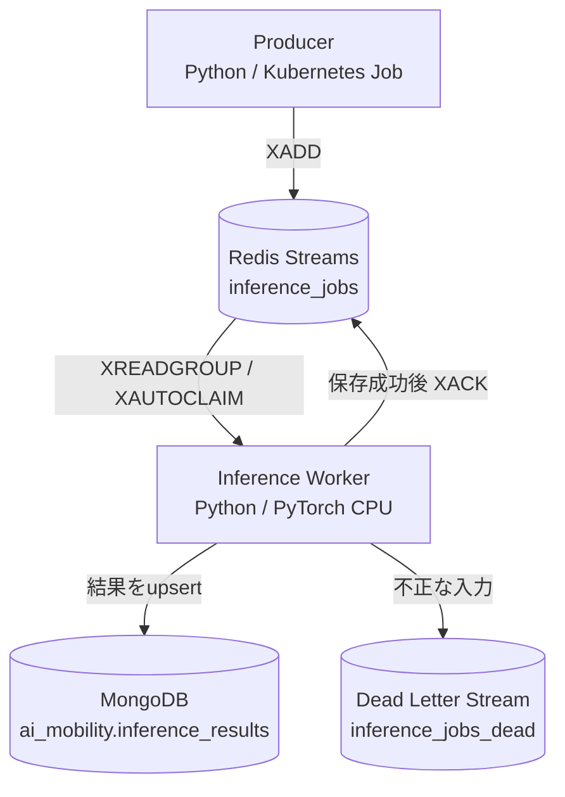

# AI Mobility Inference PoC

Redis Streams、Python / PyTorch、MongoDBを組み合わせた**非同期推論処理基盤の最小構成PoC**です。Docker Composeで動作を確認した後、ローカルKubernetes（kind）へ移行し、ジョブ投入から推論結果の保存までを検証しました。

> **位置づけ**：AIモビリティ領域のアプリケーション基盤を学習・検証するための個人PoCです。実際のVPS（Visual Positioning System）やマルチモーダルモデル、車載システムを実装したものではありません。

## 1. 構成



| コンポーネント | 役割 | 主な実装 |
| --- | --- | --- |
| Producer | 疑似推論ジョブを生成 | `src/producer.py` |
| Redis | 非同期ジョブキュー、Consumer Group | `inference_jobs` |
| Worker | ジョブ取得、入力検証、CPU推論、ACK | `src/worker.py` |
| 推論ロジック | 疑似画像テンソルの平均値を計算 | `src/inference.py`, `src/device.py` |
| MongoDB | `job_id` 単位で結果を保存 | `src/database.py` |
| Docker Compose | 3サービスのローカル実行 | `compose.yaml` |
| Kubernetes | Redis / MongoDB / Worker / Producer Job | `k8s/` |

### 推論モデルについて

入力値 `input_value` から単一チャネルの16×16疑似画像を生成し、画素値の平均をスコアとして返します。入力が `0.2` の場合は概ね `0.2` を返します。**学習済みモデルによる認識や位置推定ではありません。** GPUがない環境ではCPUを使用します。

## 2. 開発・検証環境

2026-10-20時点で動作確認した主要環境：

- WSL2 / Linux、Python 3.14
- Docker Engine 29系、Docker Compose v2
- kind v0.33.0、Kubernetesノード v1.37.0、kubectl v1.35.9
- PyTorch 2.14.1+cpu、NumPy 2.5.4
- Redis 7、MongoDB 8、redis-py 6系、PyMongo 4系
- CPU推論（CUDA/GPU推論は未検証）

Pythonライブラリの指定は [`requirements.txt`](requirements.txt) を参照してください。

## 3. Docker Composeで動かす

プロジェクトルートで実行します。

```bash
# Redis・MongoDB・Workerを起動
docker compose up -d --build redis mongo worker

# 起動状態を確認
docker compose ps

# Producerで3件投入
docker compose run --rm producer

# Workerの処理ログを確認
docker compose logs --tail=30 worker
```

結果をMongoDBで確認します。

```bash
docker compose exec -T mongo \
  mongosh ai_mobility --quiet --eval \
  'db.inference_results.find({}, {_id:1, input_value:1, score:1, device:1}).sort({input_value:1}).forEach(printjson)'

docker compose exec -T mongo \
  mongosh ai_mobility --quiet --eval \
  'db.inference_results.countDocuments({})'
```

Consumer Groupの未ACK数：

```bash
docker compose exec -T redis \
  redis-cli XPENDING inference_jobs inference_workers
```

コンテナだけ停止する場合：

```bash
docker compose down
```

> `docker compose down -v` はボリュームを削除します。保存データを残す場合は実行しないでください。

## 4. kind / Kubernetesで動かす

### 4.1 前提条件

- `docker`、`kind`、`kubectl` が利用できること
- kindクラスタが作成され、Readyになっていること
- ローカルイメージをkindに読み込むこと
- `standard` StorageClassなど、PVCをプロビジョニングできること

検証時には既存の `go-k8s-poc` クラスタを使用しました。環境に応じてクラスタ名を変更してください。

```bash
kind get clusters
kubectl get nodes
kubectl get storageclass

docker build -t ai-mobility-inference-poc:cpu .
kind load docker-image ai-mobility-inference-poc:cpu --name go-k8s-poc
```

### 4.2 マニフェスト適用

```bash
kubectl apply -f k8s/namespace.yaml
kubectl apply -f k8s/redis.yaml
kubectl -n ai-mobility-poc rollout status deployment/redis --timeout=120s

kubectl apply -f k8s/mongo.yaml
kubectl -n ai-mobility-poc rollout status statefulset/mongo --timeout=180s

kubectl apply -f k8s/worker.yaml
kubectl -n ai-mobility-poc rollout status deployment/inference-worker --timeout=120s
```

起動状態と永続ボリュームを確認します。

```bash
kubectl -n ai-mobility-poc get pods -o wide
kubectl -n ai-mobility-poc get svc
kubectl -n ai-mobility-poc get pvc
kubectl -n ai-mobility-poc logs deployment/inference-worker --tail=30
```

### 4.3 Producer Jobでジョブを投入

```bash
kubectl apply -f k8s/producer-job.yaml
kubectl -n ai-mobility-poc wait --for=condition=complete \
  job/inference-producer --timeout=120s
kubectl -n ai-mobility-poc logs job/inference-producer
```

結果と未ACK数を確認します。

```bash
kubectl -n ai-mobility-poc logs deployment/inference-worker --tail=30

kubectl -n ai-mobility-poc exec mongo-0 -- \
  mongosh ai_mobility --quiet --eval \
  'db.inference_results.find({}, {_id:1, input_value:1, score:1, device:1}).sort({input_value:1}).forEach(printjson)'

kubectl -n ai-mobility-poc exec mongo-0 -- \
  mongosh ai_mobility --quiet --eval \
  'db.inference_results.countDocuments({})'

kubectl -n ai-mobility-poc exec deployment/redis -- \
  redis-cli XPENDING inference_jobs inference_workers
```

> Kubernetes Jobは同名で再度 `apply` しても再実行されません。再実行には既存Jobの削除・再作成などが必要です。Producerは毎回新しい `job_id` を発行するため、再実行すると結果が増えます。

## 5. 障害耐性の設計

Redis Listの `BRPOP` 方式からRedis Streamsへ変更しました。

1. Producerが `XADD` でジョブを登録します。
2. WorkerがConsumer Groupの `XREADGROUP` で取得します。
3. Workerが入力値を検証し、PyTorchによるCPU推論を実施します。
4. MongoDBに `job_id` を `_id` として `replace_one(..., upsert=True)` で保存します。
5. **保存成功後にのみ `XACK`** します。
6. 未ACKのまま一定時間経過したジョブは `XAUTOCLAIM` による再取得の対象になります。
7. 不正な入力は `inference_jobs_dead` に隔離する処理を備えています。

これは**at-least-onceを目指した設計**です。ACK前にWorkerが停止すると再実行され得ます。MongoDBのupsertで同じ `job_id` のドキュメント重複を防ぎますが、すべての副作用についてexactly-onceを保証するものではありません。

**実装済みと検証済みは異なります。** Worker強制停止後の再回収、MongoDB停止時の挙動、Dead Letter Streamへの隔離は、本README作成時点では検証結果を確認できていません。

## 6. 実際の検証結果（2026-10-20）

### Docker Compose

| 項目 | 結果 |
| --- | --- |
| Redis Streamsへの投入 | 3件成功 |
| Workerでの推論 | 3件成功 |
| MongoDBへの保存 | 3件確認 |
| `XACK` | Workerログで各件 `ack=1` を確認 |
| `XPENDING` | 0件 |
| Workerログに記録された処理時間 | 112.93ms / 3.29ms / 2.34ms |

処理時間は3件の実測ログに過ぎず、ベンチマーク結果や性能保証値ではありません。

### Kubernetes（kind）

| 項目 | 結果 |
| --- | --- |
| Redis・MongoDB・Worker | 各Pod `Running` / `Ready 1/1` |
| 各Podの再起動 | 検証時0回 |
| Redis PVC / MongoDB PVC | `Bound`（1Gi / 2Gi） |
| Producer Job | `Completed`（3件投入） |
| MongoDB保存件数 | 3件 |
| `XPENDING` | 0件 |

MongoDBには次のスコアが保存されました（浮動小数点の丸め誤差あり）。

| `input_value` | `score` | `device` |
| ---: | ---: | --- |
| 0.2 | 0.20000003278255463 | cpu |
| 0.5 | 0.5 | cpu |
| 0.8 | 0.8000001311302185 | cpu |

Kubernetes上でのWorker個別の `ack=1` ログは、提示された検証ログだけでは未確認です。MongoDB保存3件とConsumer Groupの未ACK数0件は確認済みです。

## 7. テスト

ホスト側のPython仮想環境から実行します。

```bash
python -m venv .venv
source .venv/bin/activate
python -m pip install -r requirements.txt
python -m pip install pytest
python -m pytest -q
```

初期のCPU推論ロジックについては6テスト通過を確認済みです。Redis・MongoDB・Kubernetesの統合テスト、障害復旧試験は別途追加が必要です。

## 8. 制約と今後の課題

- **AI機能**：疑似画像の平均値計算のみ。実画像認識、VPS位置推定、マルチモーダル統合は未実装。
- **GPU**：CPUのみで検証。CUDA推論、GPU割当、CPU/GPU性能比較は未実施。
- **障害復旧**：`XAUTOCLAIM`・Dead Letter Stream処理は実装済みだが、強制停止・再処理試験は未完了。
- **再試行**：再試行回数の上限、指数バックオフ、恒久障害の隔離方針は未整備。
- **データ整合性**：MongoDBへの保存とRedisのACKは分散トランザクションではない。重複処理を前提とした設計が必要。
- **セキュリティ**：ローカル学習用としてMongoDB・Redisを認証なしで使用。共有・本番環境にそのまま配置しないこと。
- **可観測性**：構造化ログ、監視指標、アラート、分散トレーシングは未整備。
- **性能評価**：十分な件数によるp95/p99、スループット、エラー率、キュー滞留の検証は未実施。
- **永続性・可用性**：PVCを使用しているが、ノード障害からの復旧やバックアップ・リストアは未検証。kindの単一ノード構成に可用性の保証はない。
- **リソース**：検証時のWSL2はメモリ7.6GiB、Swap 2GiBで、Swapの空きがほぼない状態だった。負荷試験前にリソース見直しが必要。

## 9. ディレクトリ構成

```text
.
├── Dockerfile
├── .dockerignore
├── compose.yaml
├── requirements.txt
├── README.md
├── src/
│   ├── __init__.py
│   ├── main.py
│   ├── device.py
│   ├── inference.py
│   ├── database.py
│   ├── producer.py
│   └── worker.py
├── tests/
│   ├── __init__.py
│   └── test_inference.py
└── k8s/
    ├── namespace.yaml
    ├── redis.yaml
    ├── mongo.yaml
    ├── worker.yaml
    └── producer-job.yaml
```

---

本リポジトリは、非同期ジョブ実行・Kubernetesデプロイ・基本的な冪等保存・障害耐性設計の学習記録です。実装・検証の範囲と未検証事項を区別して継続的に更新します。
