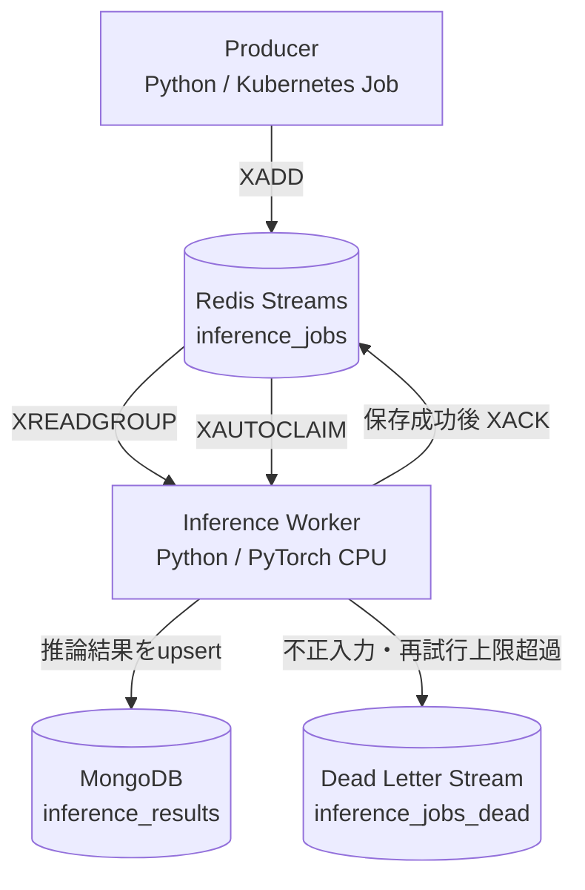

# AI Mobility Inference PoC

Redis Streams、Python / PyTorch、MongoDBを組み合わせた**非同期推論処理基盤の最小構成PoC**です。

Docker Composeで基本動作を確認した後、ローカルKubernetes（kind）へ移行し、ジョブ投入から推論結果の保存、障害発生時の再処理、性能計測までを検証しました。

本PoCでは、推論モデルの高度化よりも、**非同期処理基盤の信頼性、データ整合性、障害回復、性能評価**に重点を置いています。

> **位置づけ**
>
> AIモビリティ領域のアプリケーション基盤を学習・検証するための個人PoCです。
>
> 実際のVPS（Visual Positioning System）、マルチモーダルモデル、車載システムを実装したものではありません。
>
> 推論処理には疑似画像の平均値計算を使用しています。

## 1. システム構成



| コンポーネント | 役割 | 主な実装 |
| --- | --- | --- |
| Producer | 疑似推論ジョブの生成・投入 | `src/producer.py` |
| Redis Streams | 非同期ジョブキュー・Consumer Group | `inference_jobs` |
| Worker | ジョブ取得・検証・推論・保存・ACK | `src/worker.py` |
| 推論ロジック | 疑似画像テンソルの平均値計算 | `src/inference.py` |
| デバイス選択 | CPU / GPUデバイスの選択 | `src/device.py` |
| MongoDB | `job_id` 単位で推論結果を保存 | `src/database.py` |
| 再試行制御 | 配信回数の評価・DLQ隔離判定 | `src/retry_policy.py` |
| 性能指標 | Queue / Worker / E2Eの時間計算 | `src/performance_metrics.py` |
| Docker Compose | ローカルでのサービス実行 | `compose.yaml` |
| Kubernetes | Redis / MongoDB / Worker / Producer Job | `k8s/` |

### 1.1 推論モデルについて

入力値 `input_value` から単一チャネルの16×16疑似画像を生成し、全画素の平均値をスコアとして返します。

例えば、入力値が `0.5` の場合、概ね `0.5` が返ります。

```text
input_value
    ↓
16×16の疑似画像テンソル
    ↓
PyTorchによる平均値計算
    ↓
score
    ↓
MongoDBへ保存
```

これは学習済みモデルによる画像認識や位置推定ではありません。

GPUが利用できない環境ではCPUで推論します。本PoCのKubernetes性能測定はCPUで実施しました。

### 1.2 設計上の方針

- 推論処理とジョブ投入をRedis Streamsで分離する。
- MongoDB保存成功後にのみRedisのACKを送信する。
- 未ACKジョブは再取得・再処理できるようにする。
- 同じ `job_id` の再処理ではMongoDBのupsertを利用する。
- 再試行上限を超えたジョブはDead Letter Streamに隔離する。
- 推論処理時間と待機時間を分けて測定する。
- 実装した機能と、実際に検証した機能を区別する。

## 2. 開発・検証環境

2026年10月20日時点の主な検証環境です。

| 項目 | 環境 |
| --- | --- |
| ホスト環境 | Windows / WSL2 Linux |
| Python | 3.14系 |
| Docker Engine | 29系 |
| Docker Compose | v2 |
| kind | v0.33.0 |
| Kubernetesノード | v1.37.0 |
| PyTorch | 2.14.1+cpu |
| NumPy | 2.5.4 |
| Redis | 7系 |
| MongoDB | 8系 |
| redis-py | 6系 |
| PyMongo | 4系 |
| 推論デバイス | CPU |

Python依存ライブラリは [`requirements.txt`](requirements.txt) を参照してください。

### 2.1 検証環境の制約

WSL2のメモリは約7.6GiB、Swapは2.0GiBです。

性能測定時にはSwap使用量が上限に達していたことがあります。

そのため、本READMEに掲載する計測値には、ホストのメモリ圧迫、CPUスケジューリング、Kubernetes Podの状態などが影響している可能性があります。

**計測値は特定のローカル環境で得られた参考値であり、本番環境での性能保証値ではありません。**

## 3. Docker Composeで動かす

プロジェクトルートで実行します。

### 3.1 サービスの起動

```bash
docker compose up -d --build redis mongo worker

docker compose ps
```

### 3.2 Producerによるジョブ投入

```bash
docker compose run --rm producer
```

Workerのログを確認します。

```bash
docker compose logs --tail=30 worker
```

### 3.3 MongoDBの保存結果を確認

```bash
docker compose exec -T mongo \
  mongosh ai_mobility --quiet --eval \
  'db.inference_results.find({}, {_id:1, input_value:1, score:1, device:1}).sort({input_value:1}).forEach(printjson)'
```

保存件数を確認します。

```bash
docker compose exec -T mongo \
  mongosh ai_mobility --quiet --eval \
  'db.inference_results.countDocuments({})'
```

### 3.4 Redisの未ACK件数を確認

```bash
docker compose exec -T redis \
  redis-cli XPENDING inference_jobs inference_workers
```

正常処理が完了し、未処理のPendingが残っていなければ0件になります。

### 3.5 サービスの停止

```bash
docker compose down
```

> `docker compose down -v` はボリュームを削除します。保存データを残したい場合は実行しないでください。

## 4. kind / Kubernetesで動かす

### 4.1 前提条件

- `docker`、`kind`、`kubectl` が利用できること。
- kindクラスタが作成済みでReadyになっていること。
- Dockerイメージをkindに読み込めること。
- PVCをプロビジョニングできるStorageClassがあること。

検証には `go-k8s-poc` クラスタを使用しました。

```bash
kind get clusters

kubectl get nodes

kubectl get storageclass
```

### 4.2 Dockerイメージのビルドと読み込み

```bash
docker build -t ai-mobility-inference-poc:cpu .

kind load docker-image \
  ai-mobility-inference-poc:cpu \
  --name go-k8s-poc
```

イメージを更新した場合、kindへ再読み込みしたうえでWorkerを再起動します。

```bash
kubectl -n ai-mobility-poc \
  rollout restart deployment/inference-worker

kubectl -n ai-mobility-poc \
  rollout status deployment/inference-worker \
  --timeout=120s
```

### 4.3 Kubernetesマニフェストの適用

```bash
kubectl apply -f k8s/namespace.yaml

kubectl apply -f k8s/redis.yaml

kubectl -n ai-mobility-poc \
  rollout status deployment/redis \
  --timeout=120s

kubectl apply -f k8s/mongo.yaml

kubectl -n ai-mobility-poc \
  rollout status statefulset/mongo \
  --timeout=180s

kubectl apply -f k8s/worker.yaml

kubectl -n ai-mobility-poc \
  rollout status deployment/inference-worker \
  --timeout=120s
```

起動状態を確認します。

```bash
kubectl -n ai-mobility-poc get pods -o wide

kubectl -n ai-mobility-poc get svc

kubectl -n ai-mobility-poc get pvc

kubectl -n ai-mobility-poc \
  logs deployment/inference-worker --tail=30
```

### 4.4 Producer Jobによる投入

```bash
kubectl apply -f k8s/producer-job.yaml

kubectl -n ai-mobility-poc wait \
  --for=condition=complete \
  job/inference-producer \
  --timeout=120s

kubectl -n ai-mobility-poc \
  logs job/inference-producer
```

Kubernetes Jobは、同じ名前で再度 `apply` しても自動的には再実行されません。

再実行にはJobの削除・再作成、または別名のJob作成が必要です。

### 4.5 推論結果の確認

```bash
kubectl -n ai-mobility-poc exec mongo-0 -- \
  mongosh ai_mobility --quiet --eval \
  'db.inference_results.countDocuments({})'
```

```bash
kubectl -n ai-mobility-poc exec deployment/redis -- \
  redis-cli XPENDING inference_jobs inference_workers
```

Workerログは以下で確認します。

```bash
kubectl -n ai-mobility-poc \
  logs deployment/inference-worker --tail=30
```

## 5. 障害耐性と再試行設計

### 5.1 Redis Streamsの利用

当初のRedis Listを利用した `BRPOP` 方式から、Redis StreamsとConsumer Groupを利用する設計に変更しました。

通常処理の流れは以下です。

1. Producerが `XADD` でジョブを登録する。
2. Workerが `XREADGROUP` で取得する。
3. Workerが入力値を検証する。
4. PyTorchで推論を実行する。
5. MongoDBに結果を保存する。
6. 保存成功後に `XACK` を送信する。

MongoDBの保存が失敗した場合、通常処理のACKは送信せず、ジョブをPendingとして残します。

### 5.2 MongoDBへの冪等保存

MongoDBには `job_id` を `_id` として保存します。

```python
collection.replace_one(
    {"_id": job_id},
    record,
    upsert=True,
)
```

この方式では、同じ `job_id` が再処理された場合、同じキーのドキュメントを置き換えられます。

ただし、これはMongoDB上の重複ドキュメントを防ぐ仕組みです。

**RedisとMongoDBをまたぐexactly-once処理を保証するものではありません。**

### 5.3 Pendingジョブの再回収

Workerは `XAUTOCLAIM` を利用して、一定時間Pendingとなったジョブを再取得します。

現在の再回収閾値は次のとおりです。

```python
RECLAIM_IDLE_MS = 30_000
```

30秒以上アイドル状態のPendingジョブが再回収対象となります。

この値は障害検証用の設定です。

実運用では、正常な推論処理時間、MongoDBへの書き込み時間、負荷状態などを考慮して調整する必要があります。

### 5.4 再試行上限とDead Letter Stream

再試行制御は `src/retry_policy.py` に分離しています。

配信回数はRedisのPending情報から取得します。

```python
client.xpending_range(...)
```

検証では、配信回数が上限を超えたジョブをDead Letter Streamへ隔離する動作を確認しました。

検証した設定では、最大3回の配信を処理対象とし、4回目の配信時に再試行上限超過として隔離しました。

隔離先は以下です。

```text
inference_jobs_dead
```

隔離記録には元のStream IDやエラー理由などを記録します。

### 5.5 DLQへの登録とACK

Dead Letter Streamへの登録と元ジョブのACKにはRedisのトランザクション付きPipelineを使用します。

```python
with client.pipeline(transaction=True) as pipe:
    pipe.xadd(DEAD_LETTER_STREAM, record)
    pipe.xack(STREAM_NAME, GROUP_NAME, message_id)
    results = pipe.execute()
```

これにより、DLQ登録とACKをRedisトランザクション内で実行します。

ただし、外部システムとの整合性や障害時の全条件を保証するものではありません。

### 5.6 障害復旧の検証結果

以下のシナリオについて、動作確認を実施しました。

| 検証シナリオ | 確認結果 |
| --- | --- |
| Worker停止・Pod再作成 | Pendingジョブの再回収を確認 |
| MongoDB停止時の保存失敗 | ACKされずPendingに残る動作を確認 |
| MongoDB復旧後の再処理 | 保存成功とACKを確認 |
| 不正な入力値 | Dead Letter Streamへの隔離を確認 |
| 再試行上限超過 | 4回目の配信でDLQ隔離を確認 |
| DLQ隔離後 | 元ジョブのACKを確認 |
| 正常ジョブ | MongoDB保存とACKを確認 |

これらはローカルkind環境での検証結果です。

Redis自体の長時間停止、複数ノード障害、ネットワーク分断、永続ストレージ障害からの復旧までは検証していません。

### 5.7 処理保証の位置づけ

本PoCは**at-least-onceを目指した非同期処理設計**です。

未ACKジョブの再取得によって処理を再実行できますが、再試行上限を設けているため、すべてのジョブが必ず正常完了するわけではありません。

また、以下の制約があります。

- 同じジョブが複数回推論される可能性がある。
- MongoDB保存とRedis ACKは分散トランザクションではない。
- 再試行上限を超えたジョブはDLQへ隔離する。
- DLQからの自動再投入・再処理機能は未実装。
- 指数バックオフによる再試行間隔の調整は未実装。

## 6. 性能計測と検証結果（2026-10-20）

### 6.1 計測の目的

本PoCでは、推論処理そのものの速度だけでなく、非同期ジョブが投入されてから結果保存されるまでの時間を測定しました。

主な計測指標は以下です。

| 指標 | 意味 |
| --- | --- |
| `elapsed_ms` | Worker処理開始からACK処理後までの経過時間 |
| `queue_ms` | Redisへのジョブ登録からWorker処理開始まで |
| `worker_ms` | Worker処理開始からMongoDB保存成功まで |
| `e2e_ms` | Redis登録からMongoDB保存成功まで |
| `redis_wait_ms` | Redis登録からWorkerが取得結果を受け取るまで |
| `dispatch_wait_ms` | Redis取得結果の受信から対象ジョブの処理開始まで |

ログには以下の形式で記録します。

```text
Processed: job_id=..., stream_id=..., score=..., elapsed_ms=..., queue_ms=..., worker_ms=..., e2e_ms=..., redis_wait_ms=..., dispatch_wait_ms=..., ack=1
```

### 6.2 計測区間の関係

以下の関係が成立するように計算しています。

```text
Queue Latency
    = Redis Wait
    + Dispatch Wait

End-to-End Latency
    = Queue Latency
    + Worker Latency
```

数式では以下のようになります。

```text
queue_ms ≒ redis_wait_ms + dispatch_wait_ms

e2e_ms ≒ queue_ms + worker_ms
```

各計測値は小数点以下で丸めるため、わずかな差が生じる場合があります。

なお、`redis_wait_ms` はRedisサーバー内部の待機時間だけを表すものではありません。

先行ジョブの処理中にWorkerが次の取得APIを呼び出せない時間や、通信・応答時間も含まれます。

同様に、`dispatch_wait_ms` には先行ジョブの処理待ちや配信回数の確認処理などが含まれます。

### 6.3 Stream IDを利用した登録時刻の取得

Redis StreamsのメッセージIDに含まれるミリ秒単位のタイムスタンプを、登録時刻として利用しています。

```text
1792482417239-0
```

先頭の数値をUnix時刻のミリ秒として解釈し、Worker側で取得したUTC時刻との差分を計算しています。

この計測方法はRedisサーバーとWorkerの時刻整合性に依存します。

本PoCでは同一kindクラスタ上で検証していますが、異なるホスト間での時計ずれを厳密に補正する仕組みはありません。

### 6.4 Docker Composeの基本検証

初期の3件投入で以下を確認しました。

| 項目 | 結果 |
| --- | --- |
| Redis Streamsへの投入 | 3件成功 |
| Workerでの推論 | 3件成功 |
| MongoDBへの保存 | 3件成功 |
| `XACK` | 各件 `ack=1` |
| `XPENDING` | 0件 |
| 初期のWorker処理時間 | 112.93 / 3.29 / 2.34 ms |

この処理時間は初期動作確認時の実測ログであり、ベンチマーク結果ではありません。

### 6.5 Kubernetes基本動作

kind環境では以下を確認しました。

| 項目 | 結果 |
| --- | --- |
| Redis・MongoDB・Worker | Ready |
| Redis PVC / MongoDB PVC | Bound |
| Producer Job | Completed |
| MongoDBへの結果保存 | 成功 |
| 未ACK数 | 正常処理後0件 |
| CPU推論 | 成功 |
| Workerログ | `ack=1` を確認 |

初期の3件投入では、以下の推論結果を確認しました。

| `input_value` | `score` | `device` |
| ---: | ---: | --- |
| 0.2 | 0.20000003278255463 | cpu |
| 0.5 | 0.5 | cpu |
| 0.8 | 0.8000001311302185 | cpu |

浮動小数点の丸め誤差があります。

### 6.6 100件のPipeline投入試験

Redisへのジョブ投入方式による影響を調べるため、PythonのRedis Pipelineによる100件の一括投入を実装しました。

使用ファイル：

- `scripts/benchmark_producer.py`
- `k8s/benchmark-producer-job.yaml`

Producer側では以下の方式で投入します。

```python
with client.pipeline(transaction=False) as pipe:
    for i in range(1, count + 1):
        pipe.xadd(
            STREAM_NAME,
            {
                "job_id": f"{run_id}-{i}",
                "input_value": "0.5",
            },
        )
    pipe.execute()
```

Kubernetes Jobから投入した3回の例は以下です。

| Run ID | Producer実行時間 | 投入件数 |
| --- | ---: | ---: |
| `perf-pipeline-20261020154224` | 9.869 ms | 100 |
| `perf-pipeline-20261020155552` | 3.013 ms | 100 |
| `perf-pipeline-20261020160512` | 3.231 ms | 100 |

各試験で100件すべての保存と、最終的なPending 0件を確認しました。

Producer実行時間はRedisへの投入処理に要した時間であり、100件すべての推論完了時間ではありません。

### 6.7 Pipeline方式のE2E性能

各条件100件の計測結果です。

| Run ID | E2E平均 | E2E p95 | E2E p99 |
| --- | ---: | ---: | ---: |
| `perf-pipeline-20261020154224` | 340.510 ms | 454.554 ms | 460.938 ms |
| `perf-pipeline-20261020155552` | 97.161 ms | 162.301 ms | 166.915 ms |
| `perf-pipeline-20261020160512` | 163.619 ms | 269.401 ms | 279.541 ms |

この結果から、同じ100件のPipeline投入でもE2E時間に大きなばらつきがあることが分かりました。

原因候補には以下があります。

- Workerの初回処理・ウォームアップ
- WSL2のメモリとSwapの状態
- KubernetesのCPUスケジューリング
- Redis取得タイミング
- MongoDB保存時間
- 単一Workerによる逐次処理

これらの寄与度は未確定です。

### 6.8 待機時間の分解

Queue Latencyをさらに分析するため、次の2つに分離しました。

```text
Queue Latency
├── redis_wait_ms
└── dispatch_wait_ms
```

WorkerがRedisから最大10件を一度に取得して逐次処理する場合、後続ジョブには取得後の順番待ちが発生します。

この影響を調べるため、取得時刻 `received_at` を記録する処理を追加しました。

測定結果：

| 指標 | 平均 | p95 | p99 |
| --- | ---: | ---: | ---: |
| Redis取得前待機 | 167.340 ms | 323.177 ms | 323.177 ms |
| 取得後待機 | 14.465 ms | 29.700 ms | 36.760 ms |
| Queue合計 | 181.805 ms | 332.704 ms | 341.139 ms |

対象Run ID：

```text
perf-dispatch-20261020163402
```

投入100件、処理完了100件、Pending 0件でした。

この測定では、Queue Latencyの平均のうち約92%がRedis取得前の区間に含まれていました。

ただし、これはRedisサーバー内部で92%の時間を消費しているという意味ではありません。

### 6.9 READ_BATCH_SIZEによる比較

通常のジョブ取得に使う `XREADGROUP` のバッチサイズを変更できるようにしました。

環境変数：

```text
READ_BATCH_SIZE
```

未指定時の既定値は10です。

```python
batch_size = int(
    os.getenv("READ_BATCH_SIZE", "10")
)
```

比較した条件は以下です。

- `READ_BATCH_SIZE=10`
- `READ_BATCH_SIZE=1`

`XAUTOCLAIM` の取得件数は10のまま維持しています。

Kubernetes上でバッチサイズを1に変更する場合：

```bash
kubectl -n ai-mobility-poc set env \
  deployment/inference-worker \
  READ_BATCH_SIZE=1

kubectl -n ai-mobility-poc rollout status \
  deployment/inference-worker \
  --timeout=180s
```

10に戻す場合：

```bash
kubectl -n ai-mobility-poc set env \
  deployment/inference-worker \
  READ_BATCH_SIZE=10

kubectl -n ai-mobility-poc rollout status \
  deployment/inference-worker \
  --timeout=180s
```

`kubectl set env` による変更は稼働中Deploymentへの設定です。

マニフェストを再適用する際は、`k8s/worker.yaml` の設定との整合性に注意してください。

### 6.10 バッチサイズ別のE2E性能

それぞれ100件をPipeline投入した単発試験です。

| 指標 | count=10 | count=1 |
| --- | ---: | ---: |
| 処理成功件数 | 100 | 100 |
| E2E平均 | 183.706 ms | 184.300 ms |
| E2E p50 | 187.608 ms | 193.269 ms |
| E2E p95 | 334.119 ms | 312.091 ms |
| E2E p99 | 342.224 ms | 336.475 ms |
| E2E最大 | 346.293 ms | 338.839 ms |

対象Run ID：

```text
count=10:
perf-dispatch-20261020163402

count=1:
perf-batch1-20261020164612
```

今回の単発測定では、`count=1` のE2E p95が約6.6%短くなりました。

一方で、E2E平均はほぼ同じであり、p50はやや長くなりました。

### 6.11 バッチサイズ別の待機時間

| 指標 | count=10 | count=1 |
| --- | ---: | ---: |
| Redis取得前待機・平均 | 167.340 ms | 182.362 ms |
| Redis取得前待機・p95 | 323.177 ms | 310.541 ms |
| 取得後待機・平均 | 14.465 ms | 0.339 ms |
| 取得後待機・p95 | 29.700 ms | 0.770 ms |
| Queue合計・平均 | 181.805 ms | 182.702 ms |
| Queue合計・p95 | 332.704 ms | 310.737 ms |

取得後待機の平均は次のように変化しました。

```text
count=10 : 14.465 ms
count=1  :  0.339 ms
```

`count=1` では、取得後に他のジョブの処理完了を待つ時間が大きく減りました。

しかし、Queue Latency全体の平均はほとんど変化していません。

つまり、取得後待機の短縮が、そのままE2E性能の改善につながるわけではありません。

### 6.12 現時点での性能評価

今回の検証から、以下を確認しました。

1. 100件のPipeline投入と結果保存は正常に完了した。
2. Redisの未ACK件数は処理完了後0件となった。
3. E2E性能はWorker処理時間だけでなく待機時間の影響を強く受ける。
4. `count=1` では取得後待機が短くなる。
5. Queue全体の平均時間はバッチサイズ変更だけでは大きく改善しなかった。
6. E2E p95の差には、実行環境の変動が含まれている可能性がある。

**バッチサイズ1と10のどちらが最適かは、現時点では未判定です。**

両条件をそれぞれ複数回測定し、再現性と変動幅を比較する必要があります。

## 7. テストと分析スクリプト

### 7.1 pytest

ホスト側のPython仮想環境から実行します。

```bash
python -m venv .venv

source .venv/bin/activate

python -m pip install -r requirements.txt

python -m pip install pytest

python -m pytest -q
```

2026年10月20日時点での実行結果：

```text
27 passed
```

主なテスト対象：

| テストファイル | 対象 |
| --- | --- |
| `tests/test_inference.py` | CPU推論・推論結果 |
| `tests/test_retry_policy.py` | 再試行上限・DLQ判定 |
| `tests/test_worker_retry.py` | Workerの再試行制御 |
| `tests/test_performance_metrics.py` | 時刻・レイテンシ計算 |
| `tests/test_analyze_e2e.py` | E2Eログ解析と互換性 |

pytestでは主にロジック単位の動作を確認しています。

実際のRedis、MongoDB、Kubernetesを使った障害試験や性能試験は、これらとは別に実施しました。

### 7.2 性能分析スクリプト

| ファイル | 用途 |
| --- | --- |
| `scripts/analyze_performance.py` | Worker処理時間の分析 |
| `scripts/analyze_e2e.py` | Queue / Worker / E2E分析 |
| `scripts/analyze_dispatch.py` | Redis取得前・取得後待機の分析 |
| `scripts/benchmark_producer.py` | Redis Pipelineによるジョブ投入 |
| `scripts/run_benchmark.sh` | 繰り返し性能試験 |

### 7.3 E2E分析

Workerログを保存して分析します。

```bash
python scripts/analyze_e2e.py \
  output/worker.log \
  perf-example 100
```

主な出力項目：

```text
completed_jobs
completion_rate_percent
queue_latency
worker_latency
end_to_end_latency
```

レイテンシには以下の統計値を含めます。

```text
mean_ms
p50_ms
p95_ms
p99_ms
max_ms
```

新しい `redis_wait_ms` と `dispatch_wait_ms` を含むログ形式にも対応しています。

### 7.4 待機時間の分解分析

```bash
python scripts/analyze_dispatch.py \
  output/worker.log \
  perf-example
```

主な出力項目：

```text
completed_jobs
redis_wait_latency
dispatch_wait_latency
queue_latency
max_decomposition_error_ms
```

100件の実測では、Queue Latencyの分解誤差が0.0msとなることを確認しました。

### 7.5 PipelineベンチマークJob

Kubernetes上で使用するProducerスクリプトをConfigMapへ登録します。

```bash
kubectl -n ai-mobility-poc create configmap benchmark-producer \
  --from-file=benchmark_producer.py=scripts/benchmark_producer.py \
  --dry-run=client -o yaml | kubectl apply -f -
```

Jobテンプレートは次のファイルです。

```text
k8s/benchmark-producer-job.yaml
```

既存のJobと名前が重複しないよう、実行時にはJob名とRun IDを変更します。

Jobテンプレートでは、ConfigMap名 `benchmark-producer` は維持します。

実行例：

```bash
kubectl apply -f k8s/benchmark-producer-job.yaml
```

```bash
kubectl -n ai-mobility-poc wait \
  --for=condition=complete \
  job/benchmark-producer \
  --timeout=180s
```

```bash
kubectl -n ai-mobility-poc \
  logs job/benchmark-producer
```

同じJobを再実行する場合は、Job名を変更するか、既存Jobを削除して再作成する必要があります。

また、異なる負荷試験の結果が混ざらないよう、Run IDごとにジョブIDを分けています。

### 7.6 テスト上の注意

性能集計では、正常にACKされた対象Run IDのジョブのみを集計します。

`completed_jobs` が期待件数と一致することを確認してから、p95・p99を比較します。

ログ形式を変更すると解析スクリプトの正規表現が一致しなくなる可能性があるため、解析処理にもテストを設けています。

## 8. 制約と今後の課題

### 8.1 推論機能

- 現在は疑似画像の平均値計算のみ。
- 実画像認識は未実装。
- VPS位置推定は未実装。
- マルチモーダル統合は未実装。
- 学習済みモデルの精度評価は対象外。

### 8.2 GPU対応

- CPU推論を検証済み。
- CUDA推論は未検証。
- Kubernetes上のGPU割り当ては未検証。
- CPU / GPU性能比較は未実施。

### 8.3 障害耐性

- Worker停止からのPending再回収を検証済み。
- MongoDB停止・復旧時の動作を検証済み。
- 不正入力のDLQ隔離を検証済み。
- 再試行上限超過の隔離を検証済み。
- 指数バックオフは未実装。
- DLQからの自動再投入は未実装。
- Redis自体の障害復旧試験は未実施。
- 複数ノード障害やネットワーク分断への耐性は未検証。

### 8.4 データ整合性

MongoDB保存とRedis ACKは分散トランザクションではありません。

MongoDBのupsertにより同じ `job_id` の重複ドキュメントは防止していますが、すべての副作用についてexactly-onceを保証するものではありません。

### 8.5 セキュリティ

RedisとMongoDBはローカル学習用に認証なしで構成しています。

共有環境や本番環境へそのまま配置しないでください。

実運用では以下の検討が必要です。

- 認証と認可
- 通信の暗号化
- Kubernetes Secret管理
- ネットワーク制御
- コンテナの権限管理

### 8.6 可観測性

現在は標準出力ログによる計測が中心です。

未整備の項目：

- JSON形式の構造化ログ
- Prometheusなどへのメトリクス公開
- Grafanaダッシュボード
- アラート通知
- 分散トレーシング
- 継続的なエラー率監視

### 8.7 性能評価

100件のPipeline投入、E2E計測、p95・p99分析、バッチサイズ比較は実施済みです。

今後の課題：

- `count=1` と `count=10` の複数回比較
- ウォームアップ条件の統一
- CPU・メモリ使用率の記録
- Swap入出力の影響確認
- スループットの厳密な測定
- Workerの複数レプリカ化
- 高負荷時のエラー率測定
- SLA / SLOに基づく性能判定

### 8.8 永続性と可用性

RedisとMongoDBにはPVCを使用していますが、単一ノードkind構成です。

バックアップ・リストア、複数ノード障害、データセンター障害への耐性は検証していません。

### 8.9 今後の検証優先順位

1. WSL2のメモリ・Swap使用状況の安定化
2. バッチサイズ1と10の繰り返し比較
3. 初回推論と通常処理の時間差の分析
4. Workerの複数レプリカ化
5. Pending・DLQ件数の監視
6. 負荷試験の自動化
7. CIによるpytest実行の自動化

## 9. ディレクトリ構成

```text
.
├── Dockerfile
├── .dockerignore
├── compose.yaml
├── requirements.txt
├── README.md
├── src/
│   ├── __init__.py
│   ├── main.py
│   ├── device.py
│   ├── inference.py
│   ├── database.py
│   ├── producer.py
│   ├── worker.py
│   ├── retry_policy.py
│   └── performance_metrics.py
├── scripts/
│   ├── analyze_performance.py
│   ├── analyze_e2e.py
│   ├── analyze_dispatch.py
│   ├── benchmark_producer.py
│   └── run_benchmark.sh
├── tests/
│   ├── __init__.py
│   ├── test_inference.py
│   ├── test_retry_policy.py
│   ├── test_worker_retry.py
│   ├── test_performance_metrics.py
│   └── test_analyze_e2e.py
└── k8s/
    ├── namespace.yaml
    ├── redis.yaml
    ├── mongo.yaml
    ├── worker.yaml
    ├── producer-job.yaml
    └── benchmark-producer-job.yaml
```

`output/` には性能測定時に取得したログ・JSONレポートなどを保存できます。

実行環境固有のログや一時生成物については、必要に応じてGit管理対象から除外します。

---

## まとめ

本PoCでは、Redis StreamsとPython / PyTorch、MongoDBを利用した非同期推論処理基盤を構築し、Docker ComposeおよびKubernetes上で動作検証を実施しました。

特に以下を確認しています。

- Redis Streamsによる非同期ジョブ処理
- MongoDB保存成功後のACK制御
- Worker障害時のPendingジョブ再回収
- MongoDB停止・復旧時の再処理
- 再試行上限とDead Letter Streamへの隔離
- 100件のPipeline投入と結果保存
- Queue / Worker / E2Eレイテンシの測定
- Redis取得前待機と取得後待機の分離
- 取得バッチサイズ1と10の性能比較
- pytest 27件成功

今回の性能検証では、**取得バッチサイズを1にするとWorker内部の取得後待機は短縮されるものの、E2E性能全体の改善には直結しない**ことが分かりました。

したがって、現段階ではバッチサイズの最適値を確定せず、複数回測定による再現性の検証を今後の課題としています。

本リポジトリは、非同期処理・Kubernetesデプロイ・障害耐性・性能評価について、**設計、実装、実測、考察を段階的に積み重ねるための学習用PoC**です。
